

  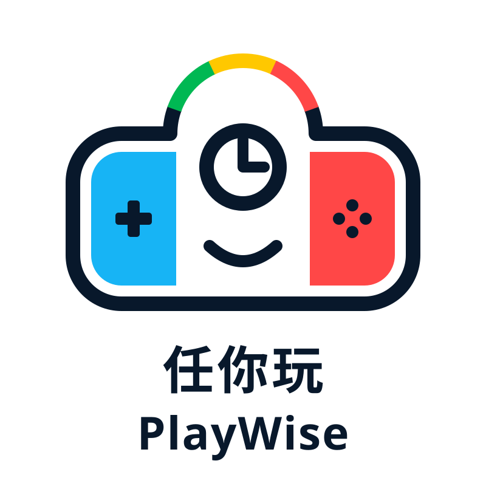

  # PlayWise

  **Play Wise. Play More.**

  [English](README_en.md) | [简体中文](README.md)

**PlayWise** (Repository: [GitHub](https://github.com/selfuppen/NX-PlayWise) · [Gitee Mirror](https://gitee.com/selfuppen/nx-playwise), Chinese name: 任我玩) is a local playtime management tool for Nintendo Switch consoles running Custom Firmware (Atmosphère recommended). Parents can configure weekly schedules, holiday allowances, and bedtime rules, or generate daily 8-character grant codes for children to redeem on the Switch. Generating and redeeming grant codes requires no internet connection on the Switch, nor any Nintendo Account or PlayWise backend servers.

## Design Philosophy

Fixed schedules provide clear, predictable routines; temporary adjustments allow flexibility for special occasions. Even when parents are away, extra playtime can be granted as a reward for children to redeem independently without constantly altering long-term rules. Temporary adjustments are valid only for the current day, automatically reverting to regular schedules the next day.

> [!WARNING]
> Stock (unmodified) retail consoles are not supported. PlayWise relies on Nintendo's native Parental Controls for accurate time tracking with Parental Controls enabled. Before installing, verify time tracking and restriction behavior on a non-critical game. Once a restriction takes effect, the PlayWise homebrew app may not be launchable; make sure to install and test the in-game overlay (Tesla Overlay) beforehand.

## Quick Start

1. Enable Nintendo Parental Controls: Settings → Parent Control settings → Parental Controls settings (restrictions set by a parent or guardian) → I do not have a smart device → Next → Next. Complete the system prompts, then verify time tracking and restriction behavior. The setup wizard also offers “Enable Controls Help” with these steps.
2. Ensure you have Atmosphère, Homebrew Menu, and Ultrahand Overlay (or another Tesla overlay menu). Note: PlayWise packages do not include overlay loaders.
3. For first-time installation, download `playwise-complete-<version>.zip`: extract `playwise-<version>.zip` for the Switch, while `playwise-offline.html` serves as a standalone offline parent web tool. Copy and merge the `atmosphere` and `switch` folders from the standard package to the root of your SD card, then reboot.
4. Launch **PlayWise** from Homebrew Menu, follow the onboarding wizard to configure the parent portal entry, PlayWise PIN, theme, and confirm takeover. When children need extra playtime, redeem codes via the homebrew app or the in-game overlay.

See the [User Guide](docs/使用/USER_GUIDE.md) for full instructions on [installation, initial setup, usage, and upgrades](docs/使用/USER_GUIDE.md).

Existing users can follow the [manual hot-update steps](docs/使用/USER_GUIDE.md#manual-hot-update-steps), then load the new backend through **Support & Recovery → Software information**. The guide also explains [versions and build IDs](docs/使用/USER_GUIDE.md#version-and-build-information-after-updating).

## Grant Code Workflow

### Redeeming Grant Codes (Children): In-Game Overlay When Restricted

> **Grant Codes**: Generating and redeeming grant codes on the Switch does not require any network connection.

Once the daily limit is reached, Nintendo's native restriction dialog may prevent Homebrew Menu and the PlayWise main app from opening. Press your configured Ultrahand/Tesla shortcut to open the overlay menu, select **PlayWise** (`playwise.ovl`), enter the 8-character code from the parent, verify the previewed result, and confirm redemption. Parents can also enter the PlayWise PIN directly in the overlay to grant one-time minutes or set unlimited play for today. Bedtime restrictions can be skipped for the current session, turned off, or reverted to pre-installation settings.

View In-Game Overlay Preview

| 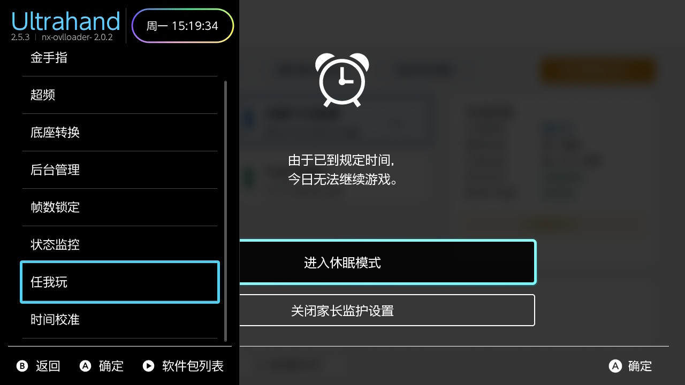 | 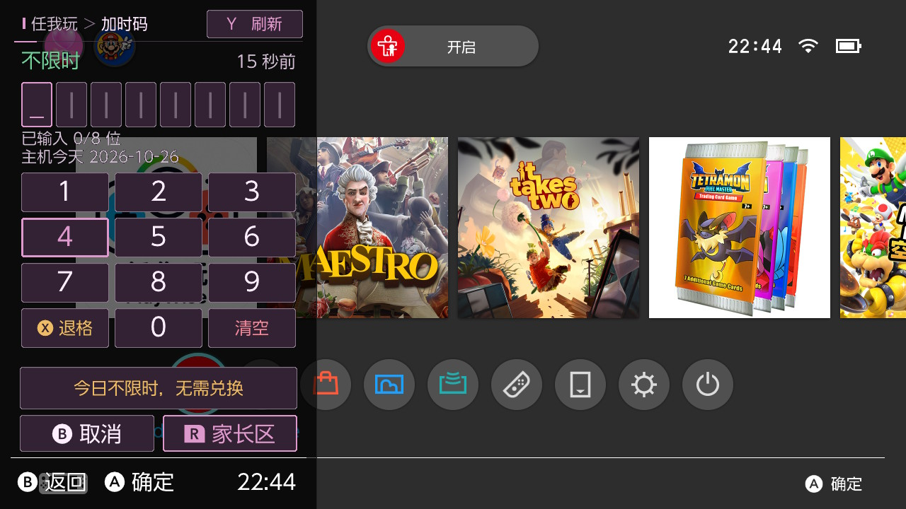 |
| :---: | :---: |

> Preview screenshots of the overlay menu and PlayWise overlay; see [Using In-Game Overlay When Restricted](docs/使用/USER_GUIDE.md#using-in-game-overlay-when-restricted) for details.

### Generating Grant Codes (Parents): Mobile QR Code Scan

> **Generating Grant Codes**:
> When scanning the QR code to open the public web generator, the parent's phone or PC needs access to GitHub Pages (`selfuppen.github.io`).
> Alternatively, you can use the standalone `playwise-offline.html` from `playwise-complete-<version>.zip`. In offline mode, your phone/PC requires no internet connection at all; once configured, the pairing key and device ID are saved locally in browser storage for repeated use. See [User Guide: Generating on Phone or PC](docs/使用/USER_GUIDE.md#generating-on-phone-or-pc) for setup and secret protection guidelines.

In the Switch Parent Portal, navigate to **Offline Grant → Generate on Phone/PC**, verify your PlayWise PIN, and display the pairing QR code. Scan it with a trusted smartphone or computer to open the [Parent Web App](https://selfuppen.github.io/NX-PlayWise/), confirm **Import Device**, select the date (matching your Switch's local date) and grant minutes, and generate the 8-character code locally. The code is calculated entirely inside your browser without uploading secrets or codes to any server, eliminating the need to rescan every time.

View Mobile Pairing & Web App Preview

| 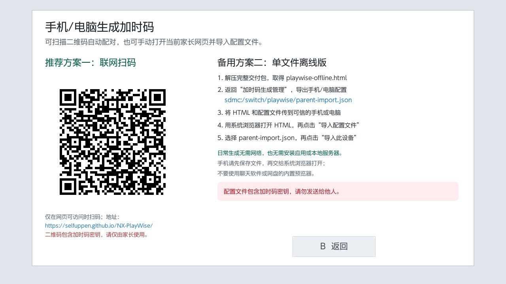 | 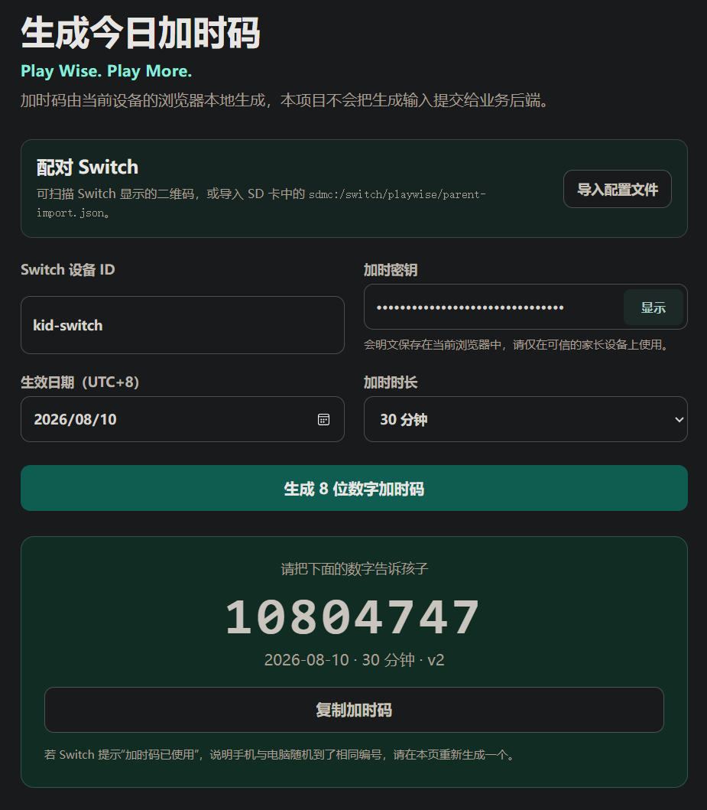 |
| :---: | :---: |

The QR code in the first screenshot uses a **public demo configuration**; do not use it on a real device. If GitHub Pages is unreachable on your network, use `playwise-offline.html` from the complete delivery bundle or generate codes directly on the Switch. Setup and security details are in [User Guide: Generating on Phone or PC](docs/使用/USER_GUIDE.md#generating-on-phone-or-pc).

## Play Restriction Reminders (Experimental)

When daily time runs out, bedtime begins, an eye-rest break is due, or TV mode rules prevent play, PlayWise can explain the reason automatically. **Detailed view** shows the current state and available actions; **Brief notice** briefly shows the reason, remaining time at the moment of the notice, and how to open details in the upper-left corner.

| Reminder settings and detailed-view example | Upper-left brief-notice example |
| --- | --- |
| 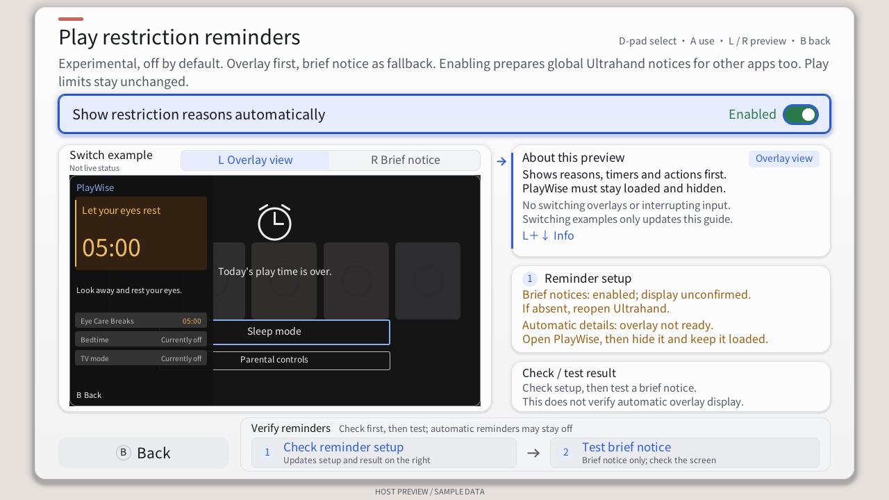 | 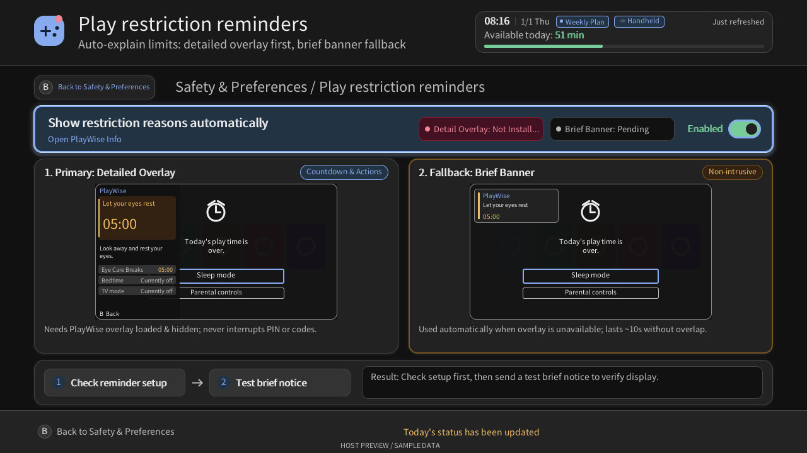 |

Enable **Show restriction reasons automatically** (off by default) in setup step two or **Security & Preferences → Play restriction reminders**. Use **1 Check setup → 2 Test brief notice** below to verify dependencies and send a test notice; press `B` to skip if anything is not ready.

Automatic details require PlayWise to stay loaded and hidden, and never interrupt PIN or code entry. When the overlay is not ready, PlayWise sends a compatible Ultrahand brief notice instead. If a test notice does not appear, reopen the overlay manager once—no console reboot is needed.

This feature is experimental and tested on **Ultrahand 2.5.3 + nx-ovlloader 2.0.2**. Brief-notice visibility over Nintendo's native lock dialog is still being refined. See [Play restriction reminders](docs/使用/USER_GUIDE.md#play-restriction-reminders-experimental), [Hint previews and setup](docs/使用/USER_GUIDE.md#hint-previews-and-setup), and the [latest hardware test record](docs/开发/验收记录/2026-11/自动化与交互/驻留简要提示修复与远程续验-20261114.md).

## Key Features

- **Play restriction reminders (experimental)**: automatic restriction explanations with detailed overlay first and brief notice fallback, plus setup checks and test notices. Ongoing eye-rest and bedtime restrictions receive remaining-time brief notices at minute intervals. See the [setup steps](docs/使用/USER_GUIDE.md#hint-previews-and-setup).
- **Configuration backup/import**: eleven selective groups, PIN/hold verification, transactional rollback, calendar restore and fresh pairing keys; available in Security & Preferences.
- **TV mode rules**: require TV mode, set a daily non-TV limit (0–1440 min within the daily total), and grant a PIN-authorized today waiver. Disabled by default.

- **Daily Dispatch**: Today's playtime limit, quick grant, unlimited play for today, and reset today's adjustments.
- **Long-Term Schedules**: Weekly schedules, statutory holidays, specific date overrides, and bedtime schedules.
- **Self Buffer**: Optional daily once-per-day 5/10/15-minute grace period buffer with detailed rule breakdowns for today and tomorrow.
- **Offline Grant Codes**: Generate 8-character grant codes on-console or via the web app; invalidated after a single successful redemption. Daily hard limits may cap added minutes below the face value.
- **Activity History**: Local family activity logs and 7/30-day playtime allowance analytics. Scoped to total console screen time; missing dates remain unknown; per-title breakdown is currently pending.
- **Support & Recovery**: Diagnostics export, emergency disable, rollback to pre-installation settings, and safe reload after in-place upgrades.

For detailed walkthroughs and [core time control logic](docs/使用/USER_GUIDE.md#core-time-control-logic) (four-tier priority pipeline and four independent gates), see the [User Guide](docs/使用/USER_GUIDE.md).

Features and typical scenarios

| Child checks today's balance and rules | Parent reviews the daily timeline and eye care projection |
| --- | --- |
| 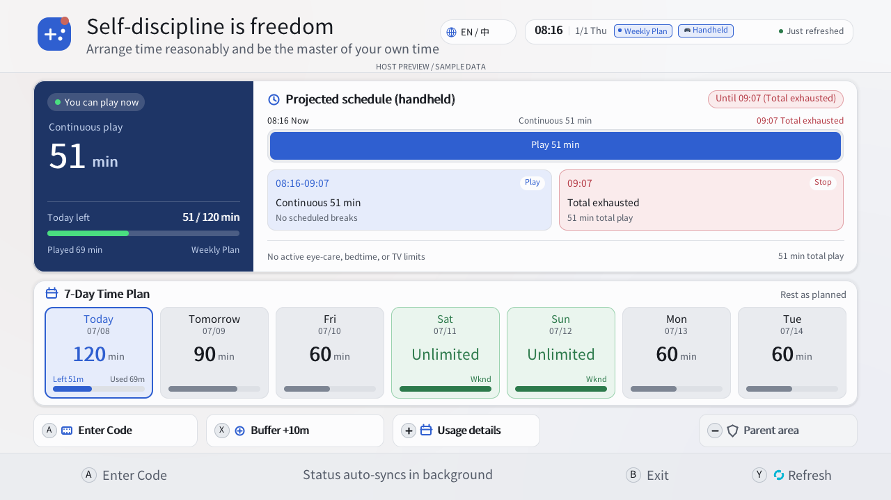 | 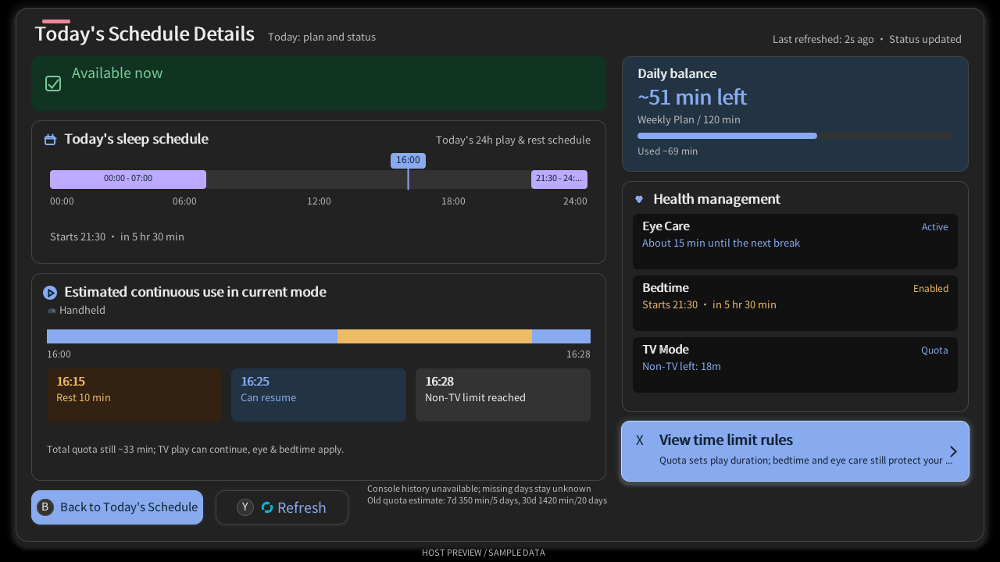 |

| Four quota sources and independent restrictions | Identify the causes when multiple limits overlap |
| --- | --- |
| 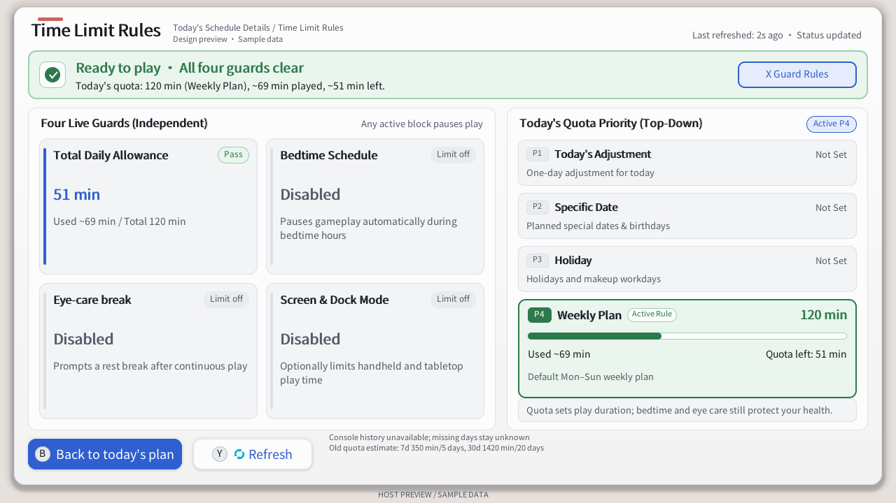 | 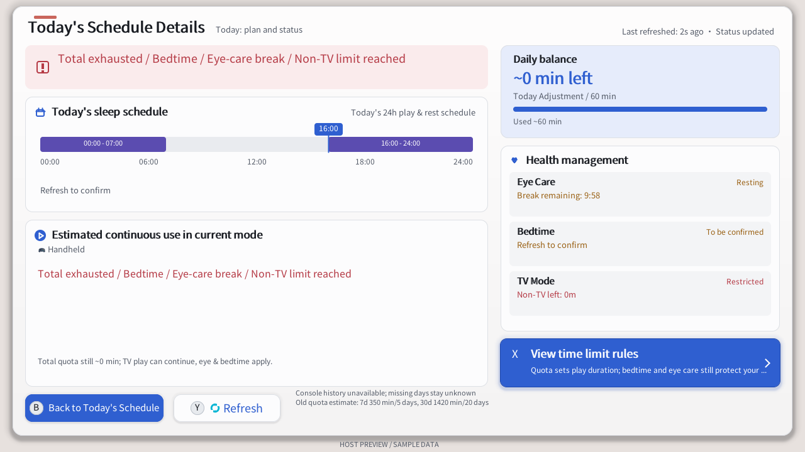 |

UI previews rendered from current code. See the User Guide for [normal use, breaks, bedtime and unconfirmed status](docs/使用/USER_GUIDE.md#viewing-todays-rule-details), plus [overlay redemption, PIN checks and usage details](docs/使用/USER_GUIDE.md#in-game-overlay-tesla-overlay).

## FAQ

> [!IMPORTANT]
> **If an error occurs, check that Nintendo Parental Controls is enabled and the Switch clock is synchronized.** Verify Parental Controls, date, time, and time zone in System Settings; sync time online with DBI or QuickNTP if needed, then refresh PlayWise and retry.
> Steps: [Enable Nintendo Parental Controls](docs/使用/USER_GUIDE.md#enable-nintendo-parental-controls) · [Synchronize the Switch Clock](docs/使用/USER_GUIDE.md#synchronize-the-switch-clock).

**Why is the game still playable when PlayWise shows "Limit Reached" / 0 minutes remaining?**
First verify that Nintendo official Parental Controls is enabled and not temporarily unlocked. Next, synchronize the Switch clock via NTP using DBI's **Tools → NTP Time Sync** or [QuickNTP](https://github.com/ppkantorski/QuickNTP), refresh PlayWise status, and retest with a non-critical game. If the issue persists, export diagnostics and see [User Guide: FAQ](docs/使用/USER_GUIDE.md#frequently-asked-questions-faq) and [Issue #1](https://github.com/selfuppen/NX-PlayWise/issues/1).

## Recommended Environment & Verification Status

- **Minimum requirements**: **Official Horizon OS (HOS) `21.0.0+`** with a matching **Atmosphère `1.10.0+`** release (core PCTL reads/writes require the HOS `21.0.0+` `0x44`-byte `145601`/`195101` layout, and hot reload / in-app online updates also rely on Atmosphère `1.10.0+`'s `pm:shell` process lookup; consoles below HOS `21.0.0` fail boot preflight—see the [minimum version dependency analysis (Chinese)](docs/调研/系统与大气层最低版本依赖调研.md)).
- **Reference environment & compatibility**: The reference test environment is **Nintendo Switch OLED, HOS 22.5.0, and Atmosphère 1.11.2**. Other HOS / Atmosphère versions meeting the minimum requirements above (including `23.0.1` / `1.12.1`) also work: PlayWise activates once on-device Parental Controls and recovery checks pass, showing a compatibility note when versions differ. Release verification details are recorded in each package's `build.json` and `qualification.json` (see [Development Environment Guide](docs/开发/DEVELOPMENT_ENVIRONMENT_GUIDE.md#full-switch-build)).

We recommend [Ultrahand Overlay](https://github.com/ppkantorski/Ultrahand-Overlay) to manage the PlayWise in-game overlay. You may also refer to the community [Atmosphère Installation & Setup Guide](https://docs.qq.com/doc/DVW9PVE5sU0FEd0tP) (QQ Group `1051287661`). External tools must be installed separately and are not bundled with PlayWise.

The PlayWise PIN is separate from Nintendo's official Parental Controls PIN—it protects only PlayWise's Parent Portal and leaves your Nintendo PIN and mobile app link untouched. Nintendo's native timer tracks total screen-on time, including HOME and System Settings ([Nintendo Support](https://support.nintendo.com/jp/switch/parentalcontrols/app/setting_change.html)).

## Roadmap

| Feature | Status | Implementation Date |
| :--- | :--- | :--- |
| Region holiday calendars | Mainland China 2026–2027 built in, with online imports for later years and [manual JSON import](docs/使用/CUSTOM_HOLIDAY_CALENDAR_FORMAT.md) | 2026-10-04 |
| Main app dark mode / 3-state theme | Implemented (overlay retains fixed dark theme) | 2026-08-13 |
| Date schedules, rule preview, daily self-buffer | Implemented (self-buffer disabled by default) | 2026-08-24 |
| Family activity history & 7/30-day allowance analytics | Implemented (missing dates marked as unknown) | 2026-08-24 |
| Bedtime schedule | Implemented (overnight schedules, background restriction, overlay recovery; disabled by default) | 2026-09-11 |
| In-game overlay: child redemption & parent quick actions | Implemented (redeem grant codes, claim self-buffer, and quick unlock via overlay) | 2026-09-28 |
| Daily dispatch dashboard & decision breakdown preview | Implemented (card grouping, temporary quota preview, decision flow drill-down) | 2026-09-29 |
| Switch-native interactive sound effects (audout engine) | Implemented (12 Switch-style sound effects and dial audio; existing sound preference preserved) | 2026-10-01 |
| Multi-language internationalization (Traditional Chinese & English) | Implemented (bilingual interface & docs, language decoupling) | 2026-10-02 |
| Destructive action long-press charge-up & safety protection | Implemented (charge-up confirmation with continuous audio feedback, instant cancel) | 2026-10-02 |
| Configuration backup & import | Implemented; full backup, 11 selective restore groups, PIN/hold confirmation, transactional rollback, calendar restore, and pairing key rotation | 2026-10-06 |
| TV mode rules | Implemented; TV-only mode, daily non-TV limit (0–1440 min, counted into daily total), and PIN today waiver; disabled by default | 2026-10-06 |
| Eye protection break | Implemented; continuous play/break cycles with skip in overlay and Today's Schedule | 2026-10 |
| [In-app online updates](docs/使用/USER_GUIDE.md#in-app-online-updates) | Implemented; automatic/manual checks, version channels, PIN/hold installation, independent pre-update backups and failure rollback; new-version hints displayed separately from data refresh status | 2026-10-28 |
| Custom shortcut recording | In validation (presets available, recording entry unreleased) | TBD |
| Multiple restricted time slots | TODO; support configuring multiple blackout/curfew intervals per day (e.g. study & dinner hours) | TBD |
| Per-title playtime statistics | TODO (`pdm:qry` hardware verification gated; currently marked unavailable) | TBD |

Besides the in-game overlay, you can temporarily unlock Nintendo's native dialog with your official Nintendo PIN, or recover via PC and SD card if both the overlay and background service are unavailable.

## Documentation

See the [documentation index](docs/README_en.md) ([简体中文](docs/README.md)) for the complete catalog and reading paths, grouped by usage, development, design, and research.

- Installation and daily use: [User Guide](docs/使用/USER_GUIDE.md) ([简体中文](docs/使用/使用指南.md))
- Getting started with development: [Development Environment Guide](docs/开发/DEVELOPMENT_ENVIRONMENT_GUIDE.md) ([简体中文](docs/开发/开发环境指南.md))

## Acknowledgements & License

Implementation concepts referenced [gmaitxqqq/switch-pctltcp-remoteandlocal](https://github.com/gmaitxqqq/switch-pctltcp-remoteandlocal) and [tailiang2008/NX-Pctl-Manager](https://github.com/tailiang2008/NX-Pctl-Manager). Released under the Apache License 2.0. PlayWise is an independent project and is not affiliated with or endorsed by Nintendo, Atmosphère, libnx, or Ultrahand Overlay.

## Download Statistics

Users in mainland China can also access the repository and downloads via the [Gitee Mirror](https://gitee.com/selfuppen/nx-playwise) and [Gitee Releases](https://gitee.com/selfuppen/nx-playwise/releases).
