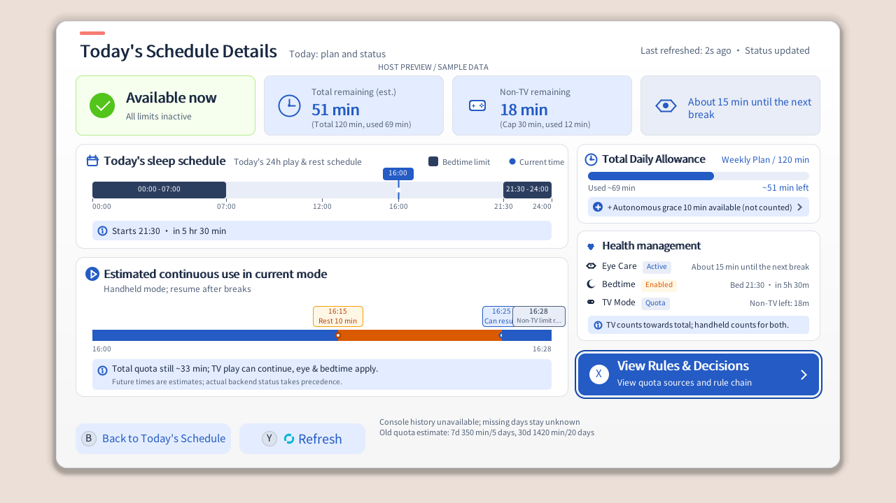
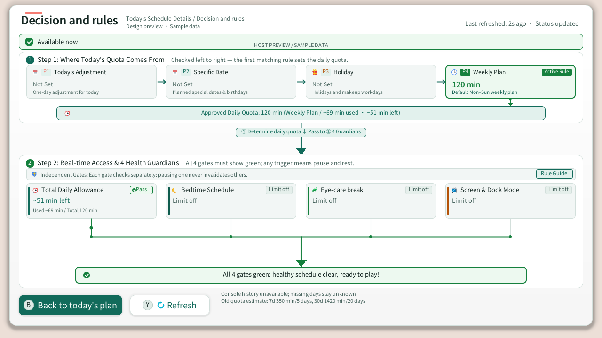
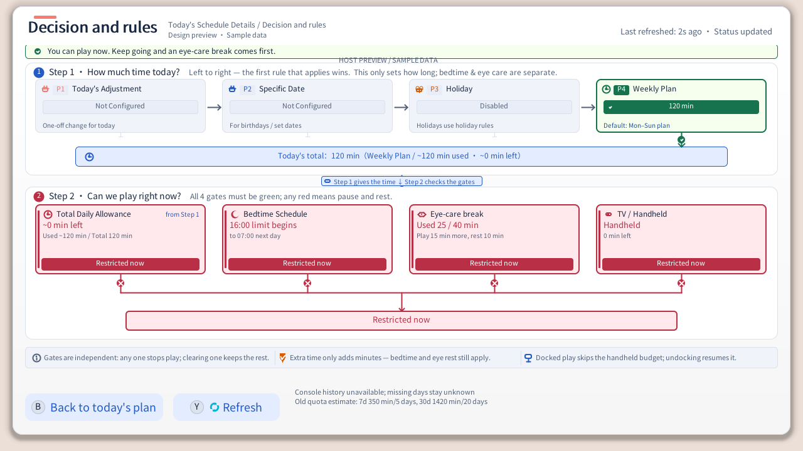

# Visual Style and Design Guide

[English](VISUAL_STYLE_GUIDE.md) | [简体中文](视觉风格与设计指南.md) | [Interactive Preview (HTML)](theme_preview.html) | [Design Index](../README_en.md#design)

This guide defines the visual design system, color palette, and layout principles for PlayWise on Nintendo Switch. It provides clear standards for Companion NRO pages, settings menus, overlays, and detail panels to ensure consistent aesthetics, high readability, and reliable rendering across handheld and docked modes. Open [`theme_preview.html`](theme_preview.html) in your browser for an interactive preview of the full light/dark palette and UI components.

---

## 1. Design Philosophy & Runtime Contracts

### 1.1 Hardware & Viewing Distances
* **Handheld Mode (720p)**: 6.2 / 7.0-inch display viewed at 30–40 cm. Requires crisp typography (body $\ge$ 12px, captions $\ge$ 9px) and clear vector primitives with distinct contrast.
* **Docked Mode (1080p)**: TV screen viewed at 2–3 m. Requires moderate color saturation, zero harsh full-screen white glare, and prominent status pills and remaining-time indicators visible from afar.

### 1.2 Software Rasterization & Geometric Micro-Aesthetics
* **Pure CPU Software Rendering**: PlayWise relies on CPU rasterization directly to the frame buffer (no GPU shaders, no hardware MSAA).
* **Lightweight Geometric Micro-Texture**:
  * Cards and panels use smooth rounded rectangles (4px / 8px / 12px / 16px).
  * Icons are drawn procedurally as compact vector micro-icons (clock, crescent moon, eye, gamepad, calendar, gift, trend lines, etc.) with 1–2px line widths for crispness and performance.
  * Status pills use subtle 4px rounded corners for a modern, breathy, flat card feel.

### 1.3 Dual-Theme System Contract
All pages must adapt seamlessly to both color modes, matching system or user preferences:
* **Light Mode**: Warm paper, mist white and graphite-cool white surfaces with low-glare ink text for bright rooms and TV viewing.
* **Dark Mode**: Per-style warm charcoal, ink-green, near-black or aubergine layers with restrained semantic tints for low-light comfort.

---

## 2. Color Palette & Semantic System

### 2.1 Base Surface & UI Styles (`companion/nro/ui_theme.c`)

PlayWise supports real-time runtime switching across 4 calibrated UI styles with zero code changes, adhering strictly to the 4-bit RGBA4444 dark contract (each channel is a multiple of 0x11; the default Graphite dark body text reaches about 13.7:1 against its card surface, and every style meets its own contrast floors). Each style owns its neutral ramp, surface layers and semantic colors; the accent is reserved for focus and primary actions:

| UI Style | Light Accent (`accent`) | Light Soft (`accent_soft`) | Dark Accent (4-bit) | Dark Soft (4-bit) | Aesthetic & Concept |
| :--- | :--- | :--- | :--- | :--- | :--- |
| **0. Graphite (Default)** | `#2F5FD0` | `#E6ECFB` | `#88AAEE` | `#223344` | Cool graphite, clear blue, product-like near-black layers |
| **1. Paper & Ink** | `#2C4A6E` | `#E7EDF4` | `#99BBDD` | `#223344` | Warm paper, ink-blue, low glare, warm-charcoal night |
| **2. Mist Teal** | `#1F6B5C` | `#E2F0EB` | `#77CCBB` | `#113333` | Mist green, porcelain teal, breathing room |
| **3. Dusk** | `#7A4670` | `#F3E8F1` | `#DD99CC` | `#332233` | Mauve-grey, plum accent, gentle and night-friendly |

#### Global Surface & Structural Colors

The table below shows the default Graphite style. Switching styles changes the neutral layers, semantic colors and Overlay palette together.

| Semantic Role | Light Mode | Dark Mode | Usage Description |
| :--- | :--- | :--- | :--- |
| **Page Background (`page_bg`)** | `#F3F4F6` | `#111111` | Cool grey / neutral charcoal canvas |
| **Base Surface (`surface`)** | `#FCFCFD` | `#222222` | Top-level cards, main panels (4-bit RGBA4444 safe) |
| **Raised Surface (`surface_raised`)** | `#E9EBEF` | `#333333` | Secondary containers, result summary cards |
| **Decorative Border (`border_decorative`)** | `#DDE0E5` | `#444444` | Subtle card dividers and panel strokes (1px) |
| **Control Border (`border_control`)** | `#7D8593` | `#888888` | Interactive buttons, inactive input frames |
| **Primary Text (`text_primary`)** | `#171A20` | `#EEEEEE` | Key headlines, major numbers, body emphasis |
| **Secondary Text (`text_secondary`)** | `#545B68` | `#BBBBBB` | Subtitles, labels, auxiliary metrics |
| **Disabled Text (`text_disabled`)** | `#7E8592` | `#777777` | Disabled actions, placeholders, decorative glyphs |

---

### 2.2 Semantic Status Colors

PlayWise follows modern UI principles pairing **saturated foregrounds with ultra-soft pastel backgrounds**. Muddy or grayish intermediate tones (such as legacy `#865600`) are strictly avoided.

#### A. Active / Success / Sufficient (Success)
* **Context**: Quota active, grant confirmed, rules satisfied, schedule running.
* **Light Mode**:
  * Soft Background (`UI_SUCCESS_SOFT`): `#EAF5EE` (restrained green)
  * Border: `#9AD2AE` (muted grass green, 1–2px)
  * Solid / Text / Foreground (`UI_SUCCESS`): `#2C7A4B` (calm green)
* **Dark Mode**:
  * Soft Background: `#113322` (deep green)
  * Border: `#336644`
  * Solid / Text / Foreground: `#77CC99` (soft bright green)

#### B. Warning / Rest / Pending (Warning)
* **Context**: Eye-care rest underway, quota running low, pending changes, bedtime approaching.
* **Light Mode**:
  * Soft Background (`UI_WARNING_SOFT`): `#FBF2E1` (warm amber cream)
  * Border: `#E4C17B` (warm amber border, 1–2px, reinforcing outer contour)
  * Solid / Text / Foreground (`UI_WARNING`): `#9A6114` (deep amber, WCAG AA >= 4.5:1 compliant)
  * Warning text on soft background (`warning_text`): `#83500C`
* **Dark Mode**:
  * Soft Background: `#332211` (deep warm brown)
  * Border: `#775522`
  * Solid / Text / Foreground: `#EEBB66` (soft warm gold)

#### C. Restriction / Danger / Exhausted (Danger)
* **Context**: Daily limit reached, bedtime lock active, quota exhausted, safety error.
* **Light Mode**:
  * Soft Background (`UI_DANGER_SOFT`): `#FAEBEC` (soft red)
  * Border: `#E2A2A8` (red)
  * Solid / Text / Foreground (`UI_DANGER`): `#B53A45` (calm red)
* **Dark Mode**:
  * Soft Background: `#441122` (deep red)
  * Border: `#882233`
  * Solid / Text / Foreground: `#EE8899` (soft coral red)

#### D. Primary Accent & Information (Accent / Info)
* **Context**: Focus rings, decision sequence pills, keyframe dots, default active segments.
* **Light Mode**: Accent `#2F5FD0` (clear blue), Soft background `#E6ECFB`.
* **Dark Mode**: Accent `#88AAEE` (mist blue), Soft background `#223344`.

---


#### E. Night & Bedtime Schedule (Night)
* **Context**: Bedtime schedule active, nightly curfew countdown, peaceful wind-down.
* **Light Mode**: Solid `#5B4CB0` (night violet), Soft background `#EDEAF9`, Border `#BDB4E8`.
* **Dark Mode**: Solid `#BBAAFF`, Soft background `#221144`, Border `#554488`.

## 3. Spatial Typography & Dynamic Alignment Contracts

To prevent text collisions across variable font widths and multiple localizations (English, Simplified/Traditional Chinese), the following rules must be maintained:

### 3.1 Edge-to-Edge Card Layout
In list rows, health-care cards, and decision cells, content must strictly separate into a **left-anchored zone** and a **right-anchored zone**:
```
+---------------------------------------------------------------------------------+
| [Icon] Title Text [Adaptive Dynamic Pill]             Right Metric & Detail Text |
| (Left-anchored: icon_x -> title_x -> pill_x)           (Right-anchored: align-R) |
+---------------------------------------------------------------------------------+
```
1. **Left-Anchoring (Dynamic Following)**:
   * Pills follow dynamically immediately after the title text. Never use hardcoded absolute X offsets.
   * Formula:
     $$\text{pill\_x} = \text{title\_x} + \text{measure\_text}(\text{title}) + 8$$
2. **Right-Anchoring (Right Alignment)**:
   * Metric and descriptive text must first measure its text width, then subtract from the right inner padding.
   * Formula:
     $$\text{desc\_x} = \text{card\_x} + \text{card\_width} - \text{padding\_right} - \text{measure\_text}(\text{desc})$$
   * This contract guarantees zero overlapping between short 4-character CJK words and longer 25-character European text strings.

### 3.2 Spacing & Grid System
* **Global Margin**: Fixed at 108px left and right; main cards occupy `1064px` width (centered across 1280px Switch resolution: $108 + 1064 + 108 = 1280$).
* **Card Padding**: Standard panels use 16px or 20px padding; compact sub-cards use 12px.
* **Vertical Rhythm**:
  * Major section gap: 16px / 20px
  * Header to sub-card gap: 12px
  * Inline icon-to-text gap: 6px / 8px


### 3.3 Classic 3-Section Console Shell Framing Contract
Across the Nintendo Switch 1280x720 global canvas, all main pages (Child Home, Parent Today) and second-level subpages (Time Plans, Settings, Offline Grants, Support & Recovery) uniformly follow the classic 3-section console shell framing:
1. **Top Header Bar (Y=0–104)**:
   * Anchored with a subtle elevated surface tint (blending 43% surface in Light mode, 47% surface in Dark mode), bounding the app icon, title, subtitle, and top-right time status capsule.
   * A full-width 1px hairline divider rule (border_decorative) spans across Y=104, establishing an architectural boundary.
   * **Status Capsule Breathing Contract**: Base position is Y=18, height 66px (vertical center Y=51 aligns harmoniously with the left app icon Y=49). When active policy rows (such as TV mode or bedtime restrictions) expand capsule height to 82px, the bottom edge is strictly clamped to Y<=94, ensuring at least 10px of clear breathing clearance to the divider line at Y=104, eliminating crowding.
2. **Central Main Stage (Y=105–651)**:
   * **Top Stage Buffer**: Navigation tabs and subpage back buttons start at Y=120 (height 38px, span Y=120~158), creating an airy 16px vertical breathing space from the top divider line (Y=104) and a balanced 14~18px space before content cards below (Y=172~176). Child mode summary and setup panels also align with Y=120, ensuring consistent rhythm across all views.
   * **Unified Stage Card & Button Shadow / Focus Contract**: Parent main menu tabs and secondary subpages share a single elevation and focus language: unfocused cards and stage buttons cast a tight, cool-slate **bottom-edge micro-shadow** (`blur=4, peak_alpha=22, y_bias=2`) paired with a `1px UI_BORDER` outline so shadows never bleed out of group trays or muddy narrow gaps; focused elements transition to `UI_ACCENT_SOFT` fill, project a floating **cool-blue ambient shadow** (`blur=9, peak_alpha=52, y_bias=3`), and render a zero-gap **2px flush `UI_ACCENT` main frame + 1px (2px docked) flush outer `UI_FOCUS` breathing ring** (3px Switch-style flush frame).
   * **Settings Secondary Pages Use the Full-Page Shell**: Appearance theme, UI language, parent shortcut keys, homebrew entry, family activity and software info no longer open as modal dialogs over the settings root. Each one repaints the whole console shell, then draws the page header and time capsule, the `B  Back to Safety & Preferences` pill and the `Safety & Preferences / <page>` breadcrumb, keeps content inside the `Y=176..651` stage and puts its actions on the footer row (`Y=664..708`). The header back pill, footer back and the B key share one rect, matching the time-plan subpages exactly.
   * **Appearance Theme Page: Two Radio Groups, One Commit**: Theme mode (Follow System / Light / Dark) and design style (Graphite / Paper & Ink / Mist Teal / Dusk) are each a radio group. Each card draws an 18px radio marker in its top-left corner: unselected is a 2px `border_control` ring, selected is a 3px accent ring with a 4px solid dot. Focus only adds the outer breathing ring and soft fill; it never changes selection semantics. Moving or tapping writes the draft and repaints the preview immediately (mode previews use the draft style). The footer primary "Confirm and save" and `A` commit both values together; `B` or the back pill discards the draft and restores the saved appearance. Above the footer the page shows `Saved: <mode> / <style>`, plus an amber `Pending: <mode> / <style>` segment on the same row while the draft differs. Per-card "Apply" buttons and "In use" badges are gone.
   * **Dock Policy Page Uses Section Cards**: The left configuration card carries the title, mode pill, intent copy and the three mode rows (the third row uses a `- / minutes / +` capsule stepper instead of text arrows). The right column stacks the usage card over the rules card, with "Rules explained" as a pill in the rules-card corner. Save and waive-today live in the footer instead of floating mid-stage.
   * **Setup Wizard: Measure Rows, Center Groups**: The setup panel (`Y=185..630`) never uses fixed row baselines. Rows are sized with the same wrapping rules the renderer draws with (`count_wrapped_lines`), each line taking `font size × 1.5`, and each of the two columns is measured at its own real width with the taller one winning. Step 1 keeps a fixed language card (`Y=185..298`) whose hints follow the measured title, and an environment card (`Y=312..618`) split by 24px padding into environment, parental control and console-time bands separated by 1px hairlines. Step 3 measures both cards first and centers the pair vertically in the panel; cards use `18px` padding, a shared `40px` title band, `12px` row gaps with the hairline on the gap's midline, and `8px` gaps between note blocks, counting a gap only when another block follows so an empty status note leaves no dead band. Page-level save failures never overprint card content: step 3 folds the message into the notes card, while steps 1 and 2 draw one fitted line in the strip between the card bottom (`Y=618`) and the stage divider (`Y=652`).
3. **Bottom Footer Bar (Y=652–720)**:
   * A full-width 1px hairline divider rule (border_decorative) spans across Y=652.
   * Y=653–719 provides a grounded dock bar surface tint (blending 70% surface_raised in Light mode, 55% surface_raised in Dark mode), with button prompts (Y=664, height 44px) perfectly vertically centered (12px top and bottom padding).
---

## 4. Key Component Standards

### 4.1 Hero Stat Cards
* **Grid**: 4 equal columns (Daily Quota, Remaining Time, Continuous Session, Current State).
* **Hierarchy**:
  * Top label: 8–9px muted uppercase tag (`UI_MUTED`).
  * Big metric: 20–24px bold figure (`UI_ACCENT` or semantic color).
  * Bottom badge: 4px rounded pill or micro-icon conveying status.

### 4.2 24-Hour Activity Track
* **Track Slot**: Height 14–18px, corner radius 8px, background `UI_RAISED`.
* **Segments**:
  * **Played Segment**: Primary accent (`UI_ACCENT`).
  * **Bedtime Lock Segment**: Dark slate / danger-soft diagonal strip with crescent moon icon.
  * **Remaining Playable**: Success border (`#9AD2AE`) or translucent accent.
* **Current Time Needle**: Vertical high-contrast line with subtle outer shadow and indicator tip.

### 4.3 Continuous Play Forecast Bar
* **Alternating Session & Rest Chunks**:
  * Play Session: Deep blue (`#1E3566` / `#2F5FD0`), rounded rectangle.
  * Rest Period: Warm amber (`#FBF2E1` bg + `#9A6114` border), displaying rest duration clearly.
  * Exhaustion Point: Pulsing micro-circle paired with an endpoint time balloon.



### 4.4 Two-Stage Decision & Rule Matrix and Natural Guidance
The view moves beyond rigid and cramped layouts, adopting conversational, parent-friendly wording and an expansive, breathing visual architecture:

* **Top Verdict Banner**: Height 34px, utilizing soft semantic backgrounds (`UI_SUCCESS_SOFT` / `UI_WARNING_SOFT`) and full-color vector Emojis (✨ normal / 🌿 eye-care first) to provide an immediate plain-language verdict on whether gaming is currently permitted. An adaptive badge on the right highlights the next key milestone (e.g., bedtime at 21:00 or impending eye-care break).
* **Stage 1: Where Today's Quota Comes From (Pipeline)**:
  * **Direct Subtitle**: "Checked left to right — the first matching rule sets the daily quota."
  * **Four Rule Pipeline Cards**: "Today's Adjustment (P1)", "Specific Date (P2)", "Holiday (P3)", and "Weekly Plan (P4)". Each card features domain full-color vector Emojis (📅 / 📅 / 🎁 / 🕒) and high-contrast priority tags.
  * **Hero Active Rule Card**: The matching rule card stands out prominently with a light-green wash, 2px vivid green border, bold 16px quota digits, and an "Active Rule" badge; downstream overridden cards are cleanly dimmed with subtle borders.
  * **Cascade Arrows & Solid Downward Injection Arrow**: Horizontal directional arrows link the pipeline stages, cutting off downstream flow at the matching rule; the active card drops an indicator line and a solid triangle downward arrow (`support_draw_arrow_down`) into a full-width summary bar (with a ⏰ Emoji) confirming total approved minutes, rule source, played time, and remaining time.
* **Stage Transition Linker (Pipeline Flow Bridge)**: A spacious 68px vertical clearway featuring a centered causal pill (`① Determine daily quota ↓ Pass to ② 4 Guardians`), paired with an emphasized conduit line and a bold 20x14px solid triangle downward arrow with 38px of unobstructed channel beneath the text pill, powerfully injecting the quota into Stage 2 access evaluation without arrow obstruction.
* **Stage 2: Real-time Access & 4 Health Guardians**:
  * **Direct Subtitle**: "All 4 gates must show green; any trigger means pause and rest."
  * **Embedded Independent Protection Action Row**: An interactive row at the top of the module presenting "🛡️ Independent Protection: the 4 gates evaluate conditions independently without interference", with a `[ Rule Guide ❯ ]` pill button. Clicking or pressing X opens a fullscreen translucent modal dialog detailing the 4 core principles: independent protection, quota pipeline priority, convergence gate, and health baseline rules.
  * **Four Compact Guardian Cards (Height 76px)**:
    * **Total Daily Allowance** (`UI_ACCENT` blue bar + ⏰ Emoji + 14px bold remaining time + secondary used summary).
    * **Bedtime Schedule** (`UI_HERO` navy bar + 🌙 Emoji + 14px restriction time + overnight schedule).
    * **Eye-care Break** (`UI_SUCCESS` green bar + 🌿 Emoji + 14px elapsed/cycle metrics + rest countdown).
    * **Screen & Dock Mode** (`UI_WARNING` orange bar + 📺 Emoji + 14px mode display + remaining time).
    * Each card embeds a compact status pill in the top-right corner (green "✓ Pass", red "✕ Blocked", or gray "Off"), saving 40px of vertical space to accommodate long, clear downstream convergence channels.
  * **Long Convergence Leads & Master Injector Arrow**: Downward leads from all four cards drop 38px into a horizontal decision bus with status solder nodes. The bus center deploys a 50px vertical main channel and a bold 22x14px solid triangle downward arrow directly injecting into the centered master gate bar. Clear states show "All 4 gates green: healthy schedule clear, ready to play!", while any blockage displays a danger warning.
* **Adaptive Multi-Context Scaling**: In tighter modal viewports such as Forecast Day Details, card heights smoothly compress, uniformly rendering the `① Determine daily quota ↓ Pass to ② 4 Guardians` bridge pill, solid downward arrow, and independent protection interactive row, with the calendar explanatory card featuring a 📅 Emoji, ensuring consistent visual elegance across all screen modes.





### 4.5 Tesla Overlay Current Design & Dark Baseline Contract
* **Tesla Host Dark Background**: The Tesla menu operates over a translucent dark background (`0x000D` / RGBA(0, 0, 0, 0.85)). To guarantee seamless integration without ocular strain, **the Tesla Overlay strictly locks to the Dark palette (`PTC_UI_RESOLVED_DARK`)**, never inheriting or following the Switch system Light theme.
* **Tuned Overlay Surfaces**:
  * Child and parent cards, code slots, keypad keys and buttons share closed rounded outlines (radius r=4 for cards/buttons, full half-height for pills). CPU span calculations render smooth rounded fills and outer borders; both normal 1px and emphasized 2px borders remain continuous without jagged seams.
  * Card Surface: `#222222` with high `0xE6` opacity, effectively shielding background game graphics.
  * Decorative Border: `#444444` with subtle `0xB0` opacity, providing restrained, clean edges.
  * Status Pills: Fully aligned with dark semantic rules (e.g. deep warm brown warning `#332211`, deep moss success `#113322`).
* **Font, Glyph & Handheld Legibility Contract**:
  * Due to Tesla sysmodule memory constraints (~6MB heap allocation), overlays cannot bundle external TTF/OTF fonts.
  * **Overlay text must never use Unicode 4-byte Emojis or miscellaneous Dingbats**, preventing mojibake or missing-glyph boxes on hardware.
  * Controller prompts must strictly use Nintendo Switch system font glyphs (e.g., `\uE0E0` for A button, `\uE0E1` for B button, `\uE0E2` for X button, `\uE0E3` for Y button, `\uE0E4` for L button, `\uE0E5` for R button, `\uE0E6` for ZL button, `\uE0EC` for touch/click).
  * The rendering layer includes a built-in UTF-8 runtime sanitizer (`ptc_overlay_sanitize_utf8`) that automatically strips out-of-range symbols before dispatching strings to `libtesla`.
  * **Layered Typography & State Hierarchy (Option B Status Banner + Rule Chain)**: Tokens live in `companion/overlay/layout.h`, establishing five clear visual tiers:
    1. **Primary Status Headline (`44px`) & Hero Metric / Countdown (`56px`)**: The top status banner claims primary focus; the headline uses `44px` semantic color (e.g. "Ready to Play", "Almost Time", "Time's Up for Today", "Time for Bed", "Rest Your Eyes", "Handheld Time Used Up"), while the remaining minutes or countdown uses `56px` hero type with a semantic soft background and 3px top semantic bar.
    2. **Brand Overline & Header Actions (`22px` brand, `24px` actions)**: Brand overline (`PlayWise` / `自律约定·任我玩` / `自律約定·任我玩`) sits on the top-left of the banner (`22px`); ` Parent` (`24px`) and ` Refresh` (`24px`) sit on the top-right side by side, completely eliminating the previous separate footer row.
    3. **Active Rule Chain Nodes (`28px` title, `26px` summary)**: Active or warning rules are connected in a vertical chain with a 10px solid colored dot, a 15px soft glow halo, and a subtle soft background surface; right-hand values are highlighted with green/orange/coral status colors.
    4. **Standby & Idle Rule De-noising (Standby `28/24px`, Idle `26/22px`)**:
       - **Standby**: Enabled rules outside active hours (e.g. daytime bedtime rule) use a 16px neutral hollow circle node with a 10px inner hole, secondary `28px` label, and `24px` secondary gray value;
       - **Idle / Off**: Disabled (`Currently off`) rules reduce to a muted 10px solid gray dot (`text_disabled`), `26px` secondary gray label, `22px` disabled gray value, and no background surface.
    5. **Action Buttons & Supporting Captions (`28px` / `24px` / `22px`)**: Bottom extra-time code button `28px`, autonomous buffer button auto-sizes across `28px / 26px / 24px`; status details entry `24px`, child guidance notes `22px`, code slot digits `40px`, and keypad digits `36px`.
* **Upward Viewport Shift & Measured Layouts**:
  * Stay inside the 448×720 sidebar, **moving the banner start up to `Y=6` and extending content down to `Y=639`**, reclaiming vertical space while strictly honoring the Tesla host footer boundary (`Y=647..720`). The top status banner and unrestricted bottom dual buttons stay fixed; intermediate guidance, rule chain, and status entries scroll in a scissored viewport.
  * Wrap Chinese at UTF-8 boundaries and English at word boundaries; split oversized words, preserve explicit newlines and blank lines.
  * Chain and banner heights adapt dynamically via font measurement in all three languages.
* **Unified Top Path Navigation & Bottom-Anchored Footer Contract (Option A: status-first)**:
  * Every page except the child overview root (parent PIN / actions / confirm / result, status details, extra-time keypad, grant confirm / result) shares one top path bar: `22px`, origin `(32,20)`, header height `44px`, divider at `Y=58`, scrolling viewport `Y=64..579` (`515px` tall). The last node is the current step in primary text; ancestors use secondary text; ASCII `>` separators use disabled text with 8px on either side, and a `4×16px` accent bar precedes the first node.
  * The root node is always “任我玩” (same in Traditional Chinese; `PlayWise` in English). Parent pages branch through “家长区”, extra-time pages through “加时码”, ending in “验证 / 确认 / 结果 / 状态详情” (`Verify / Confirm / Result / Status details`). When space is tight, truncate in the order full path → drop root → current node only; the current node never hides. The bar is read-only and adds no touch target.
  * The child overview root does not repeat a path row: its banner brand line already carries the root, and its layout stays unchanged.
  * All non-child pages share the fixed footer `Y=587..639` (`52px`, base `639`, Tesla safe line `647`): dual buttons use `154px` + `250px`, a single primary button spans `416px`. The keypad submit key occupies `Y=519..579` (`60px`) above its `Y=587..639` navigation row. Footer labels measure down `30 → 26 → 24px`; long English labels must not wrap or clip.
  * The parent status band uses `44px DISPLAY` semantic color, refresh age `24px`, group labels `22px`; action cards have a compact minimum height of `54px` (previously 96px/80px), with `28px` titles, `28px` values and `24px` reasons, inline right-aligning values when space permits. Icons and the first line of titles are mathematically centered on the same visual baseline, and all text rows align strictly to the left edge after the icon rail. Normal availability uses a card surface plus a 1px semantic border; only restricted / stale states use a semantic soft fill, so “everything is fine” never becomes the loudest element.
* **Child overview, restricted/unrestricted layout, and child-friendly phrasing**:
  * **Dark Dashboard Banner + Rule Chain**: Child overview renders smooth rounded banner surfaces, 3px colored semantic top strips, and connected node dots.
  * **Top-Right Dual Header Buttons**: Dual buttons (` Parent` and ` Refresh`) sit side by side in the banner top row.
  * **Single-Row Bottom Action Bar (Unrestricted)**: Autonomous buffer (`200px`) and extra-time code entry sit side by side in a single bottom row (`H=68`, base at `Y=639`), with L/A shortcut support and smooth controller focus navigation.
  * **No-Redundant Footer Layout (Restricted)**: The duplicate on-screen `B Back` button is completely eliminated (the Tesla footer already displays `B Back    A OK`, and physical B closes overlay), returning all bottom height to restriction cause, child next-step guidance, and recovery notes.
  * **Child-Friendly Result-Oriented Phrasing**:
    - Allowance exhausted: "Time's Up for Today", subtitle "All done today, take a break!";
    - Bedtime restriction: "Time for Bed", subtitle "Sleep well and play tomorrow";
    - Eye-care rest: "Rest Your Eyes", with live countdown and eye relaxation guidance;
    - Handheld exhausted: "Handheld Time Used Up", subtitle "Place in dock to keep playing on TV";
    - Mandatory TV mode: "TV Mode Required", subtitle "Place in dock to keep playing on TV";
    - Display "Want more time? Ask a parent" above the rule chain when restricted.
  * Eight 44×64px code slots have 5px gaps and 40px digits. The 3×4 keypad uses 124×56px keys, a 64px row step and 36px digits. Count and console date occupy separate lines; digits, submit and navigation remain accessible on one screen.
  * Confirmation and outcome comparisons prefer measured inline values with reduced repetition and padding. Common states fit on one screen in all three languages; full long rule explanations remain in status details, with scrolling reserved for details and oversized exceptional text. Minus opens independent status details from the overview or keypad; B / Minus returns.
* **Parent zone and scrolling contract**:
  * PIN entry, all eight actions, confirmation and result pages share dashboard surfaces and fixed button styling. Status, masked PIN count, confirmation explanation and result title use semantic soft panels. Action lists add group separators, optional functional icons and narrow color rails: blue for ordinary actions, coral for actions requiring hold confirmation, disabled gray for unavailable actions. Focus borders and fills follow these colors. Icons use a fixed 22px icon rail; titles and values measure the remaining width and wrap into taller cards when needed. Pending, success and failure results use orange, green and coral respectively. Active TV restrictions show their corresponding status instead of normal availability.
  * Keep all eight actions and their three groups. Measured cards use a compact minimum height of 54px (with 6px inter-card gap, title 28px, value 28px, and reasons 24px), displaying 5 to 6 actions on a single screen without scrolling. Quick-grant minutes are inline right-aligned when space allows and adjust to a separate line only when needed. Icons (22px) and title text share an exact vertical center axis (+17px relative to title line box), and all text left-aligns consistently past the 30px icon rail.
  * Focus scrolling uses actual card positions and shows the full selected card. Compute the scroll limit from measured content height. Right-stick scrolling is available outside PIN entry; explanatory pages also accept Up/Down.
  * Resolve taps on release. Movement over 10px cancels the tap and starts dragging. A drag or page transition cannot become a click; scrolled cards only receive touches inside the viewport.
  * PIN retains both sticks as digit input; touch dragging reads long instructions. Errors and cooldown appear near the entered PIN, and failed verification resets scrolling. Verify and Back remain fixed.
  * Page transitions reset scrolling; returning to parent actions follows the selected card. A 3px scrollbar indicates position. Existing authorization and one-second controller holds remain mandatory for dangerous actions.

---

## 5. Development Checklist for New Pages

The parent today page is named “今日安排” in both Chinese locales and `Today's Schedule` in English; detail titles and return prompts use the same name. Parent-entry PIN errors use the existing 760px by 360px dialog with theme-aware danger colors. Its three buttons are `B Back`, `X Support & Recovery`, and `A Re-enter`. During cooldown, retry shows remaining seconds and is disabled; back and support remain available. Measure and fit multilingual text, and share geometry between drawing and touch. The entry support button opens read-only Support & Recovery; other sensitive actions retain their troubleshooting guide button.

When authoring or updating Companion NRO pages or overlays:

- [ ] **Dual-Theme Compatible (NRO)**: All colors resolve through `palette->xxx`, `UI_xxx`, or dark/light ternaries; no hardcoded single-mode colors.
- [ ] **Overlay Dark Baseline**: Overlay strictly locks to the dark palette, with surfaces tuned to Tesla's translucent black background.
- [ ] **Overlay Zero-Emoji Contract**: Overlay strings contain no 4-byte emojis; controller prompts strictly use official Switch font glyphs (`\uE0E0`, etc.).
- [ ] **Contrast & Luminance**: Text passes legibility standards on handheld screens (Light mode primary text $\ge$ `#171A20`, Dark mode primary text $\ge$ `#EEEEEE`).
- [ ] **Semantic Color Harmony**: Active/success uses calm green (`#2C7A4B` / `#EAF5EE`), rest/warning uses deep amber (`#9A6114` / `#FBF2E1`), limits use red (`#B53A45` / `#FAEBEC`). Avoid muddy yellow/brown tones.
- [ ] **Dynamic Text Measurement**: Adjacent items and badges calculate positions dynamically using `measure_text(...)`.
- [ ] **Edge-to-Edge Right Alignment**: Right-hand descriptions and metrics align strictly via `card_x + card_w - padding - desc_w`.
- [ ] **Text Overflow Protection**: Long strings or localized variations use `fit_text(...)` with ellipses to prevent layout breaking.
- [ ] **Gamepad Focus Feedback**: Selected elements have distinct 2–3px highlight borders (`UI_ACCENT`) matching Nintendo Switch controller navigation.

## 6. Policy information in overviews

The child hero uses four compact 56px cards for quota, eye care, bedtime and TV, preserving the primary allowance and weekly forecast. Bedtime retains its clock and countdown. TV prioritizes the remaining usage and end-of-allowance guidance, followed by mode, allowance and estimated use. The parent's TV card is 70px high and retains existing touch and focus-return behavior.

The global status bar adapts to eye-care and policy rows, with its bottom no lower than y=104. Bedtime and TV summaries share two columns when both are enabled. The Overlay displays policies in individual large overview cards and complete scrollable status details. Input, submit, parent access and the Tesla footer must remain unobstructed. Boundary confirmation uses warning colors; active backend restrictions use danger colors. An empty non-TV balance on TV uses warning colors. Existing measured multilingual layouts, overflow handling, NRO themes and the Overlay dark baseline remain mandatory.
