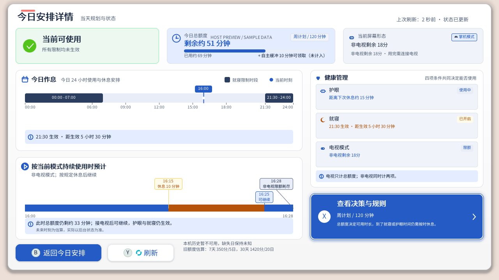
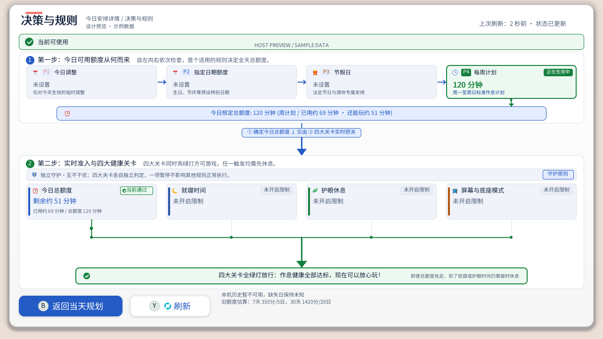
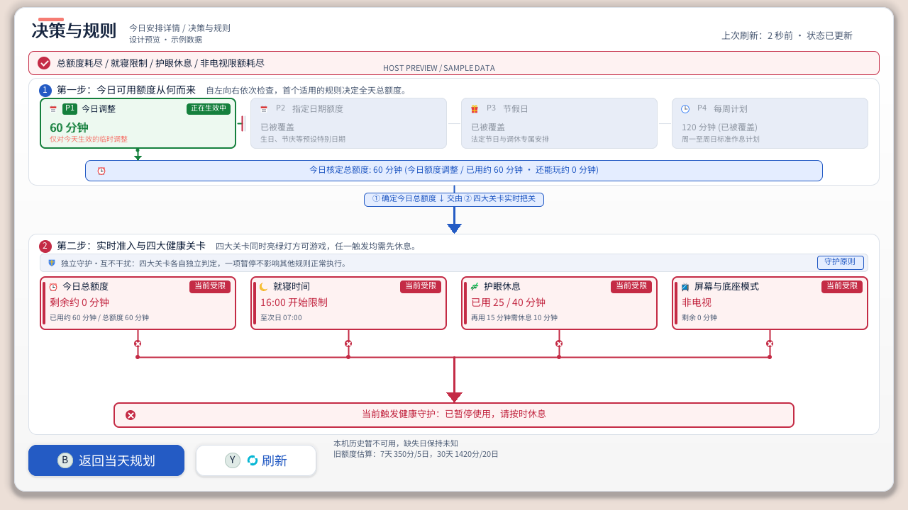

# 视觉风格与设计指南

1952直接累计候选保持现有双主题和动态文本测量布局。不限时下启用护眼／非电视计数仍显示真正“不限时”，新后台的两个 `unlimited_capped` 投影为false，不新增1440代理说明或把计数失败显示成限时；失败累计保持未知。客户端对旧候选true投影的解析只用于兼容历史结果，不表示新策略仍安装代理。Eden直接累计模拟仅验证UI及本地业务，不作为真机计时证据。

[English](VISUAL_STYLE_GUIDE.md) | [简体中文](视觉风格与设计指南.md) | [交互预览 (HTML)](theme_preview.html) | [设计索引](../README.md#设计)

本指南总结并定义了 PlayWise 在 Nintendo Switch 主机端的视觉设计系统与排版配色规范。它旨在指导后续所有 Companion NRO 页面、设置菜单、浮窗（Overlay）与详情面板的 UI 开发，确保视觉风格统一、信息层级分明、阅读舒适且在掌机与电视双端均具备高可读性。在浏览器中打开同目录下的 [`theme_preview.html`](theme_preview.html) 可交互预览全套亮/暗主题调色板与组件效果。

今日详情的规则页顶部横幅复用主页面当前状态投影；受限、恢复、待生效或陈旧状态不得显示允许游玩的固定文案，也不从每周计划猜测下一个实际就寝实例。持续使用推演的事件标签按文字测量分两行布局，限制在时间轴内部；相邻恢复与停止标签不得覆盖。极密集周期可省略放不下的早期标签并显示省略号，完整分段和最终停止仍保留；这只改变标注，不改变推演时间或控制规则。

---

倒计时的新鲜度提醒与数值分开呈现：有效快照过期、刷新失败或刷新中，Overlay/NRO 仍展示护眼与已知就寝时段的倒计时，原刷新入口与新鲜度提示保留。浮窗护眼受限页保持 56px 大字倒计时和固定操作布局，不能因超过 30 秒切回概览；NRO 保留各处周期文案。到零显示待后台确认，不表现为已解除。距离下次休息的分钟数保留最近观测，不按墙钟假扣；额度进度和实际使用读数继续受原新鲜度约束。

## 1. 设计理念与运行契约

### 1.1 硬件与场景适配
* **掌机模式 (Handheld / 720p)**：屏幕尺寸为 6.2 / 7.0 英寸，视距较近（约 30~40cm）。要求字号不可过小（正文不低于 12px，次要辅助不低于 9px），图元线条清晰、对比鲜明。
* **底座/电视模式 (Docked / 1080p)**：视距较远（约 2~3m）。要求色彩饱和度适中、避免大面积高反差纯白眩光，核心状态（剩余时间、状态胶囊）需在远处一目了然。

### 1.2 软渲染约束与几何美学
* **纯 CPU 软件光栅化渲染**：PlayWise 采用逐像素点阵绘制（无 GPU Shader 加速，无硬件多重抗锯齿 MSAA）。
* **轻量几何微质感**：
  * 卡片与面板采用平滑圆角矩形（4px / 8px / 12px / 16px）。
  * 图标采用紧凑的代码矢量微绘制（Micro Icons：时钟、新月、眼睛、手柄、日历、礼物、折线等），线宽以 1~2px 为主，兼顾渲染效率与精致感。
  * 状态胶囊使用微圆角（4px）包裹，形成轻量呼吸感与现代扁平质感。

### 1.3 双主题系统契约
所有页面必须无缝兼容并支持两种调色模式，随系统设置或用户设置即时响应：
* **浅色主题 (Light Mode)**：通透柔和，以纯白面板叠加微蓝灰背景，适合明亮光线环境。
* **深色主题 (Dark Mode)**：低眩光高对比，以深邃蓝黑配合降噪高饱和点缀，保护夜间与暗光下的用眼舒适。

---

## 2. 调色板与语义色彩规范

### 2.1 基础层级调色板 (Base Theme Palette) 与 品牌风格 (Theme Styles)

PlayWise 现已支持运行时自由切换 4 套精心校准的品牌设计风格，全端无缝联动，并在深色模式下严格遵守 4-bit RGBA4444 硬件安全契约（每个颜色通道均为 0x11 倍数，对 `#112233` 卡片底色对比度均 $\ge 6.7:1$）：

| 风格名称 | 浅色强调 (`accent`) | 浅色软底 (`accent_soft`) | 深色强调 (4-bit) | 深色软底 (4-bit) | 核心气质与设计理念 |
| :--- | :--- | :--- | :--- | :--- | :--- |
| **0. 沉静靛蓝 (Indigo, 默认)** | `#245BC4` | `#E4EDFF` | `#77AAFF` | `#223355` | 理性深邃 · 护眼专注 · 经典数码质感 |
| **1. 清爽青绿 (Teal)** | `#0D7A70` | `#E0F4F2` | `#44DDCC` | `#113333` | 自然生机 · 清新透亮 · 健康护眼 |
| **2. 暮紫星夜 (Amethyst)** | `#6340B8` | `#F1ECFC` | `#BB99FF` | `#332255` | 温和宁静 · 优雅夜空 · 梦幻柔和 |
| **3. 极简冷灰 (Slate)** | `#3B5270` | `#EAF0F6` | `#99BBDD` | `#223344` | 现代克制 · 高级冷调 · 极简工业 |

页面与面板全局色彩定义于 `companion/nro/ui_theme.c` 与 `companion/overlay/source/render_types.hpp`：

| 语义角色 | 浅色模式 (Light) | 深色模式 (Dark) | 用途说明 |
| :--- | :--- | :--- | :--- |
| **页面底色 (`page_bg`)** | `#F0F3FA` | `#111122` | 全局背景色，微偏蓝冷调，衬托前景卡片 |
| **基础表面 (`surface`)** | `#FFFFFF` | `#112233` | 顶级卡片、信息主面板表面 |
| **浮层/次级卡片 (`surface_raised`)** | `#E8EDF7` | `#223344` | 次级容器、结果汇总卡、未激活选项底色 |
| **装饰边框 (`border_decorative`)**| `#DBE1E9` | `#334455` | 面板微细描边、卡片分隔线 (1px) |
| **控件描边 (`border_control`)** | `#6E7D94` | `#778899` | 交互按钮、未激活输入框轮廓 |
| **主要文字 (`text_primary`)** | `#172640` | `#EEEEFF` | 核心标题、数字大值、高权重正文 |
| **次要文字 (`text_secondary`)** | `#53627A` | `#AABBCC` | 标签说明、副标题、辅助指标 |
| **失效文字 (`text_disabled`)** | `#9199A5` | `#667788` | 禁用项、占位说明、未命中规则副文 |

---

### 2.2 状态语义色规范 (Semantic Status Colors)

状态配色严格遵循“高饱和前景 + 超浅柔和软底”的现代设计语言，**严禁使用暗淡、发灰或脏沉的中间调（如旧版本的土黄灰 `#865600`）**。

#### A. 可用 / 生效 / 充沛 (Success)
* **适用场景**：额度生效、加时成功、条件全部满足、计划已启用、作息时间进行中。
* **浅色模式**：
  * 软底 (`UI_SUCCESS_SOFT`)：`#EDF9F0`（极浅薄荷浅绿）
  * 边框：`#86EFAC`（透亮浅草绿，1~2px）
  * 实体/胶囊/前景 (`UI_SUCCESS`)：`#15803D`（活力翡翠绿）
* **深色模式**：
  * 软底：`#113322`（深翡翠绿）
  * 边框：`#226633`
  * 实体/胶囊/前景：`#55DD77`（高亮荧光草绿）

#### B. 提醒 / 休息 / 暂缓 (Warning / Rest / Pending)
* **适用场景**：护眼休息中、额度即将耗尽、待定生效、就寝倒计时预警。
* **浅色模式**：
  * 软底 (`UI_WARNING_SOFT`)：`#FFFBEB`（温暖柔和杏白/米白）
  * 边框：`#FCD34D`（暖琥珀橙边框，1~2px，强化外缘轮廓）
  * 实体/胶囊/前景 (`UI_WARNING`)：`#B45309`（高对比暖琥珀橙，满足 WCAG AA >= 4.5:1 可读性要求）
* **深色模式**：
  * 软底：`#332211`（深暖褐棕）
  * 边框：`#885511`
  * 实体/胶囊/前景：`#FFBB33`（明快暖金橙）

#### C. 限制 / 熔断 / 危险 (Danger / Exhausted)
* **适用场景**：已达上限强制锁屏、就寝时段禁用、额度耗尽、安全模式告警。
* **浅色模式**：
  * 软底 (`UI_DANGER_SOFT`)：`#FEF2F2`（淡粉樱软底）
  * 边框：`#FCA5A5`（粉红细边框）
  * 实体/胶囊/前景 (`UI_DANGER`)：`#C42B45`（明艳红蔷薇）
* **深色模式**：
  * 软底：`#441122`（暗樱红）
  * 边框：`#882233`
  * 实体/胶囊/前景：`#FF7788`（荧光亮珊瑚红）

#### D. 主品牌与信息 (Accent / Info)
* **适用场景**：今日规划标题圆点、选中高亮、折线推演关键帧、默认活动段。
* **浅色模式**：主色 `#126B5B`（青绿 Teal），软底 `#E4EDFF`。
* **深色模式**：主色 `#33DDBB`（碧水青绿），软底 `#223355`。

---


#### E. 夜间与就寝作息 (Night)
* **适用场景**：就寝计划进行中、夜间宵禁倒计时、就寝时段锁屏（区别于惩罚性额度用尽，采用宁静星夜紫）。
* **浅色模式**：实体/文字 `#5B47D6`，软底 `#F0EDFF`，边框 `#C4B5FD`。
* **深色模式**：实体/文字 `#AA99FF`，软底 `#221144`，边框 `#5544AA`。

## 3. 空间排版与端对端动态对齐契约

为解决不同字体、中繁英多语种文本宽度变化导致的“文字重叠、穿插溢出”等顽固 UI 缺陷，本系统确立以下排版铁律：

### 3.1 卡片内部“两端对齐”规范 (Edge-to-Edge Layout)
在列表行、健康管理卡片、规则决策单元中，内容必须划分为明确的**左侧定宽区**与**右侧动态区**：
```
+---------------------------------------------------------------------------------+
| [Icon] 标题文本 [动态自适应胶囊]                           右侧数值与详细说明文字 |
| (左锚定: icon_x -> title_x -> pill_x)                       (右锚定: 严格向右对齐) |
+---------------------------------------------------------------------------------+
```
1. **左锚定（动态紧跟）**：
   * 胶囊紧随标题之后，严禁使用写死的 X 坐标偏移。
   * 计算公式：
     $$\text{pill\_x} = \text{title\_x} + \text{measure\_text}(\text{title}) + 8$$
2. **右锚定（向右对齐）**：
   * 右侧状态、详细规则与用量说明，必须先测量文本渲染宽度，再逆向减去右内边距。
   * 计算公式：
     $$\text{desc\_x} = \text{card\_x} + \text{card\_width} - \text{padding\_right} - \text{measure\_text}(\text{desc})$$
   * 该契约能从根本上杜绝中文 4 汉字与英文 20 字母在同坐标下发生覆盖踩踏。

### 3.2 网格与间距系统 (Spacing & Grid)
* **全局容器左右留白**：固定为 108px，主体卡片统一宽度为 `1064px`（Switch 1280 物理像素宽度中居中：`108 + 1064 + 108 = 1280`）。
* **卡片内边距 (Padding)**：标准面板内边距为 16px 或 20px，紧凑型单元为 12px。
* **垂直间距 (Spacing Scale)**：
  * 大区块间距：16px / 20px
  * 标题与子卡片间距：12px
  * 行内图文间隔：6px / 8px


### 3.3 经典主机三段式通栏外框规范 (Classic 3-Section Console Shell)
在 Nintendo Switch 1280×720 全局画布中，所有主页（儿童端、家长端今日安排）、设置向导与二级子页（时间计划、设置、离线加时、支持与恢复等）统一遵循经典三段式通栏外框架构：
1. **顶部通栏 Header Bar (Y=0~104)**：
   * 采用微通栏底色（浅色混合 43% surface，深色混合 47% surface），牢牢锚定应用图标、主副标题与右上角时间状态胶囊。
   * Y=104 处贯穿全宽 1px 装饰分割线（border_decorative），为顶栏提供清晰的物理分界。
   * **状态胶囊呼吸契约**：基础位置为 Y=18，高度 66px（垂直中心 Y=51 与左侧应用图标 Y=49 对齐）。当电视模式或就寝限制等生效策略行使高度扩展至 82px 时，胶囊底边缘严格限制在 Y<=94，确保与 Y=104 顶部底边缘分割线之间留出至少 10px 的舒展空隙，杜绝贴边压迫。
2. **中部主内容舞台 (Main Stage, Y=105~651)**：
   * **顶部分界缓冲**：Tab 导航胶囊与二级子页返回键起点统一下移至 Y=120（高度 38px，范围 Y=120~158），在顶部分割线（Y=104）与导航栏之间留出宽敞的 16px 呼吸间距，并在导航栏下沿（Y=158）与业务卡片区（Y=172~176）之间留出均衡的 14~18px 空间。儿童端总结卡与向导面板亦统一对齐 Y=120 起点，全应用保持一致节奏。
   * **业务卡片与舞台按钮统一阴影/悬浮契约**：家长页主菜单（5 个顶栏页）与二级子页（每周计划、国家节假日、就寝时间、护眼休息、电视模式规则）的舞台卡片与操作按钮共用同一套微立体与获焦语言——未获焦常态采用冷调深灰蓝**极轻底边投影**（`blur=4, peak_alpha=22, y_bias=2`）配 `1px UI_BORDER` 柔和描边，杜绝阴影溢出分组托盘或染灰窄缝；获焦/悬浮态切换为 `UI_ACCENT_SOFT` 柔光底色，向外投射**冷蓝环境悬浮投影**（`blur=9, peak_alpha=52, y_bias=3`），并紧贴卡片边缘绘制 **2px `UI_ACCENT` 实心主框 + 外侧紧贴 1px（底座 2px）`UI_FOCUS` 呼吸外框**，形成零黑缝的 3px Switch 原生风贴边宽框。
   * **设置二级页统一为整页页壳**：外观主题、界面语言、家长区快捷键、自制程序入口、家庭活动记录与软件信息不再以弹窗叠在设置根页上，而是整页重绘图标页头、时间胶囊、`B 返回安全与偏好` 胶囊与 `安全与偏好 / <页面名>` 面包屑，内容落在 `Y=176..651` 舞台，动作统一落在底栏 `Y=664..708`；返回胶囊、底栏返回与 B 键命中同一矩形，与时间计划二级页完全同构。
   * **电视模式规则页采用分区卡片**：左侧配置卡放标题、模式徽标、意图说明与三个模式行（第三行用「- / 分钟 / +」胶囊步进器替代文本箭头），右侧上下叠放用量卡与规则卡，「规则详解」为规则卡右上角胶囊；保存与今日解除落在底栏，不再悬浮在舞台中部。
   * **向导内容按测量分行、成组居中**：设置向导（面板 `Y=185..630`）不写死行基线，改用与绘制同一套换行规则统计行数（`count_wrapped_lines`），逐行高度取 `字号 × 1.5`，左右两列各按自身真实列宽测量后取较高者。第 1 步语言卡（`Y=185..298`）为定高卡，其提示文字紧随测量后的标题右移；环境卡（`Y=312..618`）以 24px 内边距分出运行环境、家长控制、校时三段，段间以 1px 分隔线均分。第 3 步两张卡先测量再在面板内垂直居中，卡片内边距 `18px`、标题统一占用 `40px` 标题带，行间隔 `12px`，分隔线落在间隔中线；提示卡内各段间隔 `8px`，且仅在其后仍有内容时才计入间隔，避免空状态提示在卡底留下死白。页面级保存失败提示不覆盖卡片正文：第 3 步并入提示卡末段，第 1、2 步单行绘制在卡片下沿（`Y=618`）与舞台分割线（`Y=652`）之间的留白带。
3. **底部通栏 Footer Bar (Y=652~720)**：
   * Y=652 处贯穿全宽 1px 装饰分割线（border_decorative）。
   * Y=653~719 采用停泊底栏底色（浅色混合 70% surface_raised，深色混合 55% surface_raised），手柄按键指引（Y=664，高度 44px）在 68px 底栏内垂直居中对齐（上下边距各 12px）。
---

## 4. 关键组件视觉规范

### 4.1 顶部关键指标卡片 (Hero Stat Cards)
* **布局**：一行动态四等分（如：今日总额度、剩余可用、单次连续、当前状态）。
* **视觉层次**：
  * 顶部小字：8~9px 灰色标签（`UI_MUTED`）。
  * 中部大字：20~24px 加粗关键数值（`UI_ACCENT` 或语义状态色），一目了然。
  * 底部徽章/图元：4px 圆角微胶囊或微图标，展示详细进度与当前状态。

### 4.2 24小时全天作息时间轴 (24h Activity Track)
* **轨道槽**：高度 14~18px，圆角 8px，底色采用 `UI_RAISED` 或 `0xE0E6F0`。
* **时间分段渲染**：
  * **已游玩段**：主强调色（`UI_ACCENT`）。
  * **就寝封锁段**：深冷灰蓝或危险软底条纹，配有小月亮标记。
  * **剩余可用段**：浅薄荷绿（`#86EFAC`）或半透明主色。
* **当前时间游标**：竖直高亮白线带双像素外阴影，顶部可配微倒三角指针。

### 4.3 模拟推演预测条 (Continuous Play Forecast Timeline)
* **连续游玩段与休息段交替**：
  * 游玩段：饱满鲜蓝（`#1890FF` / `#245BC4`），圆角矩形。
  * 休息段：温暖亮橙（`#FFFBEB` 底 + `#FA8C16` 边框），醒目标识休息时长。
  * 耗尽节点：小圆点带呼吸光圈，右侧配有预测终点时间气泡。



### 4.4 决策与规则页：两段式把关矩阵与亲切导引 (Two-Stage Decision & Rule Matrix)

页面全面摆脱紧凑刻板感，采用通俗亲切的口语化表达与大开大合的开阔布局，纵向层级清晰分明，全屏高度呼吸感充足：

* **顶部综合态势条 (Top Verdict Banner)**：高度 34px，以浅软底（`UI_SUCCESS_SOFT` / `UI_WARNING_SOFT`）配合全彩矢量 Emoji（✨ 状态良好 / 🌿 护眼优先）呈现当前能否开玩的大白话综合结论。右侧自适应显示下一个关键作息节点胶囊（如“今晚 21:00 就寝”或“护眼休息倒计时”）。
* **第一步：今日可用额度从何而来 (Stage 1 Pipeline)**：
  * **主副标题清晰直白**：“自左向右依次检查，首个适用的规则决定全天总额度”。
  * **4 张高优先级规则流水卡片**：依次排列“今日调整 (P1)”、“指定日期额度 (P2)”、“节假日 (P3)”、“每周计划 (P4)”。各卡片配备专属全彩矢量 Emoji（📅 / 📅 / 🎁 / 🕒）及高对比度芯片标签。
  * **高亮 Hero 命中卡片**：生效规则卡片享有高对比醒目处理（浅绿底色、2px 活力鲜绿描边、16px 加粗大字显示核定分钟、右上角鲜绿“正在生效中”徽章），已覆盖的后序卡片则以浅灰弱化。
  * **卡片级联中线与实心纵向箭头**：卡片间以 2px 中线及单向箭头贯穿，命中规则处切断后续流向；生效卡片底部通过粗导流线与实心平滑三角箭头（`support_draw_arrow_down`）垂直注入全幅核定总额度结果条（左侧配 ⏰ Emoji），清晰总结今日核定总时长、判定来源、已用时长与净剩余。
* **因果流向指示 (Stage Pipeline Flow Bridge)**：从第一步结果条正下方留出 68px 大净空垂直通道，设置优雅圆角流向胶囊（`① 确定今日总额度 ↓ 交由 ② 四大关卡实时把关`），配合加粗导引主管线与 20x14px 实心向下大三角箭头，强力垂直注入第二步“实时准入”，且文字胶囊置于上方，下方留足 38px 舒展流道，箭头完全不被文字条框遮盖，使两段式因果逻辑方向跃然纸上。
* **第二步：实时准入与四大健康关卡 (Stage 2 Guardians & Convergence Gate)**：
  * **副标题清晰释义**：“四大关卡同时亮绿灯方可游戏，任一触发均需先休息”。
  * **模块内嵌独立守护交互行**：顶部设置全宽交互条，展示“🛡️ 独立守护·互不干扰：四大关卡各自独立判定，一项暂停不影响其他规则正常执行。”，右侧提供 `[ 守护原则 ❯ ]` 药丸按钮。点击或按下 X 键即以全屏半透明模态弹窗形式展开《规则决策与独立守护说明》，详述独立守护、额度优先级、综合把关与健康底线四大核心原则。
  * **4 张专属守护卡片（高度紧凑压缩至 76px）**：
    * **今日总额度**（`UI_ACCENT` 蓝色条 + ⏰ Emoji + 14px 剩余时间大字 + 今日已用次要副文）。
    * **就寝时间**（`UI_HERO` 深蓝条 + 🌙 Emoji + 14px 开始限制时刻 + 跨夜时间段提示）。
    * **护眼休息**（`UI_SUCCESS` 绿色条 + 🌿 Emoji + 14px 累计/周期时长 + 休息倒计时）。
    * **屏幕与底座模式**（`UI_WARNING` 橙色条 + 📺 Emoji + 14px 当前模式 + 剩余可用时间）。
    * 各卡片右上角配备紧凑状态胶囊（如绿底“✓ 放行”、红底“✕ 阻断”或灰底“未开启”），卡片受限时整卡底色及边框统一转为危险红色。通过右上角紧凑化，卡片高度压缩 40px，为下方汇流腾出充足纵向空间。
  * **长轴汇聚引线与终极判定大闸门 (Convergence Gate)**：
    * 每张卡片底部引出长达 38px 的垂直导流线，中间镶嵌放行圆点或阻断交叉节点，汇入横向贯通总线；
    * 汇聚总线中央以粗壮主管线及 22x14px 实心向下大三角箭头（通道跨度 50px 以上）垂直强力注入总闸门横条；
    * 全绿灯时以成功色显示“四大关卡全绿灯放行：作息健康全部达标，现在可以放心玩！”，任一阻断时切换为危险色并明确提示休息要求。
* **全生命周期自适应**：在预报详情（Forecast Details）与单日决策详情等弹窗中，两步卡片自适应收敛，两区块间统一渲染 `① 确定今日总额度 ↓ 交由 ② 四大关卡实时把关` 桥接胶囊与实心向下大箭头，点击独立守护行同样支持呼出全屏规则说明弹窗，日历解读卡片配备 📅 Emoji，完美兼顾全屏与紧凑视口。





### 4.5 Tesla Overlay 当前方案与深色基准契约 (Tesla Overlay Current Design & Dark Baseline Contract)
* 状态详情按“现在怎样 → 为什么 → 背景数据”三层组织：顶部先显示当前状态横幅（44px 语义色 + 24px 刷新时间），再用时间卡显示今日额度与剩余限制说明，然后是“控制规则与策略”分组的护眼/就寝/电视三条规则，最后是默认折叠的“技术诊断与通道信息”。含独立usage的快照中，本机使用与原捕获UTC日期时间移入折叠区，先显示本机使用，再显示原捕获时间；未知用量使用提醒色“不可用”，捕获说明使用次要文字。这些行继续按实际文本测量、换行与视口滚动，不缩小字级，也不把原捕获改为刷新时刻。
* **Tesla 宿主半透明黑底**：Tesla 菜单采用全局半透明深黑底色（`0x000D` / RGBA(0, 0, 0, 0.85)）。为保证在任何系统主题下与宿主面板视觉融为一体，**Tesla Overlay 严格锁定深色基准调色板（`PTC_UI_RESOLVED_DARK`）**，严禁读取或跟随 Switch 系统的浅色（Light）模式，彻底杜绝刺眼亮白大卡片造成的对比度崩溃。
* **深色微质感卡片表面**：
  * 儿童区与家长区的卡片、输入槽、键盘及按钮统一使用平滑圆角边框（标准卡片与按钮半径 r=4，胶囊为半高圆角）；通过 CPU 像素跨度算法绘制平滑圆角填充与外描边，普通 1px 与高亮 2px 边框均饱满闭合且无锯齿断口。
  * 卡片背景表面：`#112233`，结合 `0xE6` 高不透明度，阻隔底层游戏画面的强光干扰。
  * 卡片装饰描边：`#334455`，结合 `0xB0` 低反差微描边，呈现克制柔和的毛玻璃边界。
  * 状态胶囊与软底：完全对齐深色语义规范（例如深暖褐棕警告底色 `#332211`、暗翡翠绿可用底色 `#193C32`）。
* **字体字模与掌机大字契约**：
  * 受 Tesla 插件运行常驻内存限额（约 6MB 配额）限制，Overlay 严禁内嵌引入庞大的外部 TTF/OTF 字体文件。
  * **Overlay 所有文案严禁使用 Unicode 4 字节 Emoji 或彩色杂项符号（Dingbats）**，以防在真机上渲染为缺失字形（豆腐块方框）或乱码。
  * 所有按键操作与手柄引导一律采用 Nintendo Switch 官方系统内置按键字模（如 `\uE0E0` 代表 A 键、`\uE0E1` 代表 B 键、`\uE0E2` 代表 X 键、`\uE0E3` 代表 Y 键、`\uE0E4` 代表 L 键、`\uE0E5` 代表 R 键、`\uE0E6` 代表 ZL 键、`\uE0EC` 代表触摸/点击等）。
  * 底层渲染管线内置 `ptc_overlay_sanitize_utf8` 运行时文本过滤防护，在任何文本送入 `libtesla` 绘制前自动剥离超界 Emoji 与特殊符号，确保极致鲁棒性。
  * **分层字体与视觉层级契约（方案 B 状态横幅 + 规则链）**：字号集中于 `companion/overlay/layout.h`，建立清晰的五级视觉层次与逻辑状态区分：
    1. **当前状态大标题（44px）与状态核心数值 / 倒计时（56px）**：顶部状态横幅独占最关键视觉焦点；状态大标题使用 `44px` 语义色（如“现在可以玩 / 快到时间啦 / 今日时间已用完 / 到睡觉时间啦 / 让眼睛休息一下吧 / 掌机时间用完啦”），关键剩余时间或倒计时使用 `56px` Hero 大字，配合深色基准语义软底、顶部 3px 语义色彩条，一眼锁定当前最关键状态与结论。
    2. **品牌 overline 与顶行快捷入口（品牌 22px，顶行按钮 24px）**：品牌名“自律约定·任我玩”（繁体“自律約定·任我玩”，英文 `PlayWise`）置于横幅顶行左侧（`22px`，“·任我玩”使用主题强调色高亮）；顶行右侧将 ` 家长区`（`24px`）与 ` 刷新`（`24px`）并排排布，彻底消除以往单独占据底部的冗余行。
    3. **生效 / 告警规则链节点（标题 28px、摘要 26px）**：处于启用、预警或生效中的规则以竖向链条节点呈现，左侧配备实心彩色节点（10px 圆点）与柔和彩色光晕（15px 半透明圈），背景辅以极淡语义软底；右侧状态值使用对应绿/橙/红语义色高亮，体现核心守护进行时。
    4. **待命 / 闲置规则层级降噪（待命 28/24px、闲置 26/22px）**：
       - **待命（Standby）**：规则启用但当前未到触发时段（如就寝规则在白天），使用次要灰空心圆环节点（16px 外圆、10px 内孔），标题 28px、摘要 24px 次要灰；
       - **闲置 / 未开启（Idle）**：未开启（`当前关闭`）的规则卡退化为 10px 低对比小实心灰点（`text_disabled`），标题 26px 次要灰、摘要 22px 禁用灰，无背景软底面板，消除无用视觉噪音。
    5. **操作按钮与辅助标注（28px / 24px / 22px）**：底部加时码按钮 `28px`，自主缓冲按钮根据空间自适应 `28px / 26px / 24px`；状态详情入口 `24px`，辅助说明与儿童导引 `22px`；输入插槽数字单独使用 `40px`，数字键盘使用 `36px`。
* **大字优先、顶部空间利用与共享测量布局**：
  * 主内容保持在 448×720 浮窗内，**充分利用顶部空间，将横幅起点置于 `Y=6`、主内容区完整展开至 `Y=639`**，释放顶部约一行大标题的纵向空间，同时严守 Tesla 页脚（`Y=647..720`）安全边界。顶部状态横幅与未受限时的底部双按钮固定，中间导引、规则链与状态入口在独立裁剪视口内滚动。
  * 中文按 UTF-8 字符边界换行，英文优先按词换行；超长单词按字符拆分，显式换行与空行保留。主要说明完整展示，不用缩小字号或省略号维持一屏密度。
  * 规则链与横幅高度根据实际三语文字测量自适应计算；未受限与受限状态一律在三语中一屏完整显示。生产绘制与 Host 预览共用同一渲染实现；输入使用绘制发布的 `PtcOverlayPageLayout`，不另写命中坐标。
* **统一顶部路径导航与页脚贴底契约（方案 A：状态主导）**：
  * 除儿童概览根页外，所有页面（家长 PIN / 动作 / 确认 / 结果、状态详情、加时码输入、加时确认 / 结果）共用同一顶部单行路径栏：`22px`，起点 `(32,20)`，页头高 `44px`，分隔线 `Y=58`，滚动视口 `Y=64..563`（高 `499px`）。最后节点表示当前步骤并使用主文字色；祖先节点使用次要文字色；节点间使用 ASCII `>` 与禁用色分隔，分隔符左右各留 8px，首节点前绘制 `4×16px` 强调竖条。
  * 路径根节点固定为“任我玩”（繁体同名，英文 `PlayWise`）；家长区分支为“家长区”，加时码分支为“加时码”，末端分别为“验证 / 确认 / 结果 / 状态详情”。空间不足时按“完整路径 → 去掉根节点 → 仅保留当前节点”逐级裁剪，当前节点永不隐藏。路径栏只读，不新增触摸命中区。
  * 儿童概览根页不重复路径行：横幅品牌行“自律约定·任我玩”已经表达根节点，保持原布局。
  * 所有非儿童根页面的固定页脚统一为 `Y=571..639`（高 `68px`，底边 `639`，Tesla 安全线 `647`）：双按钮为左侧 `154px`、右侧 `250px`；单主按钮为全宽 `416px`。加时码键盘的提交键为 `Y=503..563`（高 `60px`），导航按钮为 `Y=571..639`。页脚文字按 `30 → 26 → 24px` 测量自适应，英文长标签不得折行裁切。
  * 家长区状态带使用 `44px DISPLAY` 语义色，刷新时间 `24px`，分组标签 `22px`；动作卡最小高度 `96px`，标题 `32px`、数值 `34px`、原因 `24px`。正常状态使用卡片底 + 1px 语义描边，仅受限 / 待刷新才使用语义软底，避免“一切正常”反而最醒目。
* **儿童概览、受限/未受限布局与儿童友好口吻**：
  * **深色仪表盘横幅 + 规则链**：儿童页面使用 CPU 像素图元绘制平滑圆角横幅表面、顶部 3px 彩色语义条以及带连线圆点的竖向规则链。
  * **右上角双按钮页眉**：儿童概览页（无论受限或未受限）统一将 ` 家长区` 与 ` 刷新` 并排置于横幅顶行右侧，省出一整行底部纵向空间留给规则与状态说明区。
  * **未受限时的单行底部操作栏**：未受限时，底部操作区合并为单行双按钮（`H=68`，底边对齐 `Y=639`），左侧放置自主缓冲按钮（`200px`，` 领取自主缓冲` / `缓冲暂不可领` / `缓冲今日已领`），右侧放置加时码入口（` 输入加时码`，强调色描边与微底），支持 L/A 快捷键与平滑方向键焦点切换。
  * **受限时的无冗余页脚布局**：受限时，**彻底取消底部重复的 `B 返回` 按钮**（因 Tesla 宿主底部栏已固定展示 `B Back` 与 `A OK`，物理 B 键与方向键均可直接关闭浮窗），且 ` 家长区` 已移至右上角，底部空间全部归还给限制原因、儿童下一步导引与恢复说明视口。
  * **面向儿童的结果导向口吻**：当剩余时间归零或触发就寝、护眼、电视/底座限制时，告别生硬的“还剩 0 分钟”“非电视剩余 0分”或面向家长的配置术语，改用对孩子说话的简洁结果表述：
    - 额度用尽：标题“今日时间已用完”，副标题“今天玩够啦，休息一下吧”；
    - 就寝限制：标题“到睡觉时间啦”，副标题“好好休息，明天再玩吧”，说明时段及早睡提示；
    - 护眼休息：标题“让眼睛休息一下吧”，搭配清晰倒计时与“看看远处或闭目养神，倒计时结束就能继续玩啦”；
    - 掌机模式额度用尽：标题“掌机时间用完啦”，副标题“放回底座连电视，就能继续玩”；
    - 强制底座模式：标题“现在需要连电视玩”，副标题“放回底座连电视，就能继续玩”；
    - 受限画面在规则链上方统一展示“想继续玩，请找爸爸妈妈”，为孩子指引明确的下一步。
  * 输入页保持八个 44×64px 插槽、5px 间距，数字为 40px；3×4 键盘按键为 124×56px、行步长 64px、数字 36px。输入计数和主机日期分行，数字键、提交和导航始终一屏可操作。
  * 确认与结果页的前后时间优先同行显示，压缩重复提示与留白。常见状态在三语中均一屏显示；完整长规则说明集中在状态详情，详情及超长异常内容保留滚动兜底。减号键可从概览或键盘进入独立状态详情，B / 减号键返回。
* **家长区与滚动交互契约**：
  * PIN、八项操作列表、确认及结果页共用深色仪表盘表面与固定按钮样式。状态摘要、PIN 输入数量、确认说明及结果标题使用语义软底面板；列表增加分组细线、功能图标与状态色条。确认页不再重复当前状态横幅（可能与“就寝已跳过”等警告自相矛盾），改为标题即动作名、正文说明影响与仍生效的规则；结果页只保留一条 44px 结果标题，动作名降为 28px 次要文字，补充说明与错误码降为 28px/22px，错误码使用次要色，使家长第一眼看到结论而不是日志。普通动作使用蓝色，需长按确认的动作使用珊瑚红，不可用动作使用禁用灰；焦点描边与软底跟随对应色。图标仅在测量确认标题一行容得下时显示，不改变卡片高度。处理中、完成、失败结果分别使用亮橙、绿和珊瑚红；电视限制显示对应状态，避免显示正常可用。
  * 保留八项动作与三组视觉顺序（`ptc_overlay_parent_action_order()`，输入、绘制与滚动共用同一映射）：“今日额度”（快速加时、今日不限时）→“现在受限的规则”（跳过本次就寝、跳过本次休息、恢复本次就寝、关闭就寝计划、今日解除电视模式限制）→“系统恢复”（恢复安装前设置并停用）。分组回答“今天想改什么”，每组标题下配一行 22px 次要色说明（仅今天生效 / 临时放开规则 / 会停用 PlayWise），说明不是命中区域。动作卡最小高度 96px，标题 32px、数值 34px、原因 24px，长标题与原因增高；快速加时的分钟数和左右调整提示分行。
  * 手柄焦点根据实际卡片位置平滑滚动，保证选中卡片完整可见。滚动上限由测量出的内容高度计算；右摇杆可自由滚动，说明页也支持上下方向键。
  * 触摸松开时才产生点击；移动超过 10px 视为拖动，拖动松开或跨页手势不得触发点击。列表命中必须同时在视口与滚动后的卡片范围内，不能穿透固定标题或按钮。
  * PIN 页面保留原来双摇杆的数字输入，可触摸拖动长说明；错误与冷却说明置于输入提示之后，验证失败自动回到顶部。验证、返回始终固定。
  * 页面切换重置滚动，返回家长动作列表时重新跟随选中项；右侧 3px 滚动条指示当前位置。危险操作沿用原有手柄长按 1 秒与授权契约。

---

## 5. 新页面开发与色彩自查清单 (Checklist)

家长区今日页统一称“今日安排”（繁体同名；英文 `Today's Schedule`），详情与返回提示使用同一名称。进入家长区的密码错误复用 760px × 360px 错误弹窗，使用危险软底与双主题语义色；底部并排提供 `B 返回`、`X 支持与恢复`、`A 重新输入`。冷却时重新输入显示剩余秒数并禁用，支持与返回仍可操作。三语按钮与正文须经过文本测量和防溢出处理，绘制与触摸共用几何。该入口的支持按钮主动跳转只读支持页，其他敏感操作保留排障说明按钮。

在为 Companion NRO 或 Overlay 增加或修改界面时，请逐项检查：

- [ ] **双主题适配 (NRO)**：所有色彩均使用 `palette->xxx`、`UI_xxx` 或带有亮暗主题自适应三元判断，无硬编码单一模式颜色。
- [ ] **Overlay 暗色基准**：Overlay 独立锁定深色主题调色板，卡片底色适应 Tesla 半透明黑底，绝不跟随 Light 模式。
- [ ] **Overlay 无 Emoji 契约**：Overlay 文案绝无 4 字节 Emoji 或未支持字符，按键统一使用 Switch 官方字模转义符（如 `\uE0E0`）。
- [ ] **高可读性明度**：文字与背景之间的对比度满足掌机屏幕阅读需求（浅色模式正文字色 $\ge$ `#172640`，深色模式正文字色 $\ge$ `#EEEEFF`）。
- [ ] **语义色彩一致**：成功/生效用活力鲜绿（`#52C41A` / `#EDF9F0`），休息/提醒用高对比暖橙（`#D95A00` / `#FFFBEB`），危险用粉红蔷薇（`#B92F46` / `#FFE9ED`），无暗沉发灰脏黄色。
- [ ] **动态文本测量**：所有同行相邻文本或指示胶囊均通过 `measure_text(...)` 动态计算起止位置，杜绝写死 X 偏移。
- [ ] **右侧端对端对齐**：列表项与卡片内部的右侧数值、状态说明文字严格按照 `card_x + card_w - padding - desc_w` 动态右对齐。
- [ ] **长文本防溢出**：对可能包含长字符串或本地化扩展的内容，使用 `fit_text(...)` 限制最大渲染宽度并自动省略。
- [ ] **焦点交互反馈**：当前选中项有清晰的高亮轮廓线（2~3px `UI_ACCENT`）与背景反馈，符合 Nintendo Switch 手柄操作直觉。

## 6. 概览中的规则信息布局

儿童 Hero 右侧使用额度、护眼、就寝、电视四张 56px 紧凑卡，左侧主额度与下方周历保持原有空间。就寝卡保留时刻与倒计时；电视卡先展示余额与到额提示，再展示模式、限额与已用估算。家长今日安排的电视卡扩为 70px，保留状态卡的触摸和焦点返回契约。

全局状态栏按护眼和规则摘要的存在调整高度，底边不超过 y=104；就寝和电视同时启用时摘要分列，不覆盖页面导航。Overlay 的规则摘要使用概览中的独立大字卡片，完整内容放入可滚动状态详情；不可覆盖输入、提交、家长入口或 Tesla 页脚。倒计时到边界使用待确认提醒色；真实限制才使用危险色，电视连接时非电视用尽使用提醒色。三语文本测量、防溢出、NRO 双主题和 Overlay 固定暗色规范继续适用。

## 今日主机累计显示

主机使用详情的健康行采用真实策略投影：标签紧随实测标题宽度，右侧说明按可用空间裁剪后右对齐，两者保留至少8px间距；不得把长英文说明覆盖标签。关闭用次要色，未知/休息用提醒色，实际限制用危险色。护眼摘要显示真实周期或关闭/待确认，生产详情及决策页移除设计示例副标题。过期/刷新失败时本机累计隐藏旧数字、进度清空，原历史下界继续明确标注。三语双主题预览包含关闭、过期、休息和未知场景。

Overlay的本机使用累计始终按同一后台结果的完成时间减原捕获时间，加从该请求派发前开始的单调耗时，保守核对120秒新鲜度。Tesla跳过libnx时间初始化时，正数的本地time值也可能只是启动后秒数，因此不能用“正数”判断它是有效Unix日期。超过边界、未来捕获或时间来源缺失仍显示不可用，原捕获文案与值不改变。该规则仅用于本机使用累计，不自行确认就寝/护眼/电视政策或给持久旧结果续期。

具有 `usage` 来源的今日累计标为“本机使用”，范围是游戏、HOME、设置正常可用期间，不显示成纯游戏时长。旧后台/v1历史仍保留估算标识。日额度与进度分母取当日forecast，累计超额不抬高额度；缺额不能用120分钟默认值或“累计+剩余”绘制有效进度。独立累计的捕获时刻超过120秒、回拨或读取失败显示待确认/不可用，不在UI递减。BLOCKED执行0与业务额度分开；本阶段不迁移健康功能基线。三语浅暗预览继续遵循主题、动态测量及防溢出契约。

快速加时确认保留typed纳秒累计，按业务日额度与向上取整累计的较大值追加，显示余额向下取整并遵守1440分钟上限。累计未知、日期或新鲜度不可靠时显示暂不可用，不用钳制剩余加面额制造确定余额；保存后以后台结果为准。上限零增量不消耗代码或缓冲，三语错误文案同时解释授权范围与今日上限。

今日详情底部将近7/30天用量按来源分为两行：新记录称“本机累计（部分观测）”，旧记录称“旧额度估算”，各自显示分钟数和有读数的日期数，不能相加。保留历史值时明确标注最近读取失败；无已知日期显示不可用，缺失日不当零。两行沿用语义次要文字与测量/换行裁剪，不增加输入或控制操作，三语深浅主题提供混合、失败和未知预览。历史文字不宣称完整全天、纯游戏时长或某个孩子的使用量。

Overlay儿童政策卡以后台回执的本地日内秒和绑定请求单调耗时判断新鲜度；有效回读的就寝关闭应显示关闭，不因未初始化的客户端墙钟持续待确认。保持未满30秒门禁，缺失/不匹配时刻、跨午夜或到达政策边界仍待刷新确认。护眼剩余休息可用单调耗时投影，电视余额不随时间递减；调色板、动态测量、布局和主题契约不变。


### 同候选采集重启提示

仅当已准备的同候选采集重启请求通过源boot、run及配置原字节校验时，在正常PIN后的家长区沿用确认弹层，标题明确“重新启动后台”，正文说明加载已准备采集、租期从新后台启动起算及取消后保持运行。软件信息使用“重启后台”按钮；未认证只读支持区保留关闭操作，不显示或命中重启。使用原双主题语义色、字体测量、换行及共享按钮几何，不把相同release显示成新版升级。三语深浅样例为 `settings/settings-capture-restart[-confirm]-{light,dark}`，Host预览不代替真机观察。
