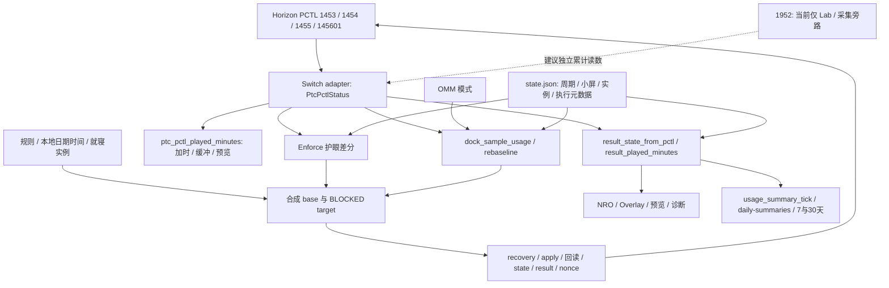

> 专题分析：保留原调查日期、源码基线及未证明边界，不代表当前候选资格或可直接执行的步骤。见[调研分类](../README.md)及[当前进度](../../开发/当前进度与后续指导.md)。

# PCTL1952 功能影响分析与最小修改方案

分析日期：2026-10-14（Asia/Shanghai）。源码基线：`1aca74b5162de73ce3b59969a16274e69b47b26c`，分支 `feat/probe-playtime-gpt6.1`。本轮仅创建此报告；未修改产品算法、协议、资格文件或真机状态，未提交 Git。附件目录及原 Overlay 排查文档保留。

## 1. 结论与分析边界

**1952 应成为“今日主机累计使用”的直接数据来源候选；1454 应保留带符号原值，儿童可用余额另做非负投影。** 当前算法的问题已由代码与真机链路共同证实，不能继续用钳制后的剩余反推超额累计。游戏、HOME、系统设置正常可用期间累计、受限不可用及真休眠期间冻结，符合用户接受的口径；不是游戏前台时长，也不是全部亮屏时长。

**替换显示来源不等于替换所有策略。** 护眼需要独立的周期累计和休息证明；就寝需要绝对时间窗口与实例；电视模式需要 OMM 模式归因。1952 只提供当天总消费，不提供这些信息。三项功能继续保持各自 `pending` 资格，不自动提升 `qualified`。

**接入必须拆开三种值：真实累计、业务额度、PCTL 当前执行配置。** 60 分钟业务额度遇到就寝/护眼/电视限制时，执行配置可以是 BLOCKED/0，而当天真实累计仍可能是 69 分钟。把执行 0、钳制余额 0 或 1440 代理当成真实累计或业务额度，会影响显示、加时、历史及恢复。

报告标记约定：

- **[缺陷]**：当前代码可证明，给定输入即可复现；真机已发生与纯代码反例分别注明。
- **[建议]**：证据支持的改进，尚未实现。
- **[产品]**：需要确认或明确写入产品契约的取舍；已存在的契约默认保留，不要求本轮重新确认。
- **[待验]**：代码能解释设计意图，真机没有覆盖目标行为。
- **[迁移风险]**：直接替换字段后会引入的问题，不能写成当前产品已经发生的事故。

P0 表示后续实现/发布必须阻断的安全条件；P1 表示应随本次数据来源修正处理的功能错误；P2 表示精度、历史与可观测性改进。此报告没有证明一个新的 P0 真机管控绕过事故。

## 2. 证据台账

证据根为 `device-reports/usage-20261013/`，被 Git 忽略。下表路径均相对此根；机器读数、人工观察、失败批次及后续补充分别保留。离线报告中的旧 `pending` 字段可能是早期结论；以相应后续批次和最终汇总为准，不能修改旧记录以统一措辞。

|编号|原始/派生入口|支持的事实|严格边界|
|---|---|---|---|
|E1|`final-review.html`；`pctl-mainline/final-evidence.json` 的 `old_scoped_evidence`|游戏 182 秒增 182 秒；HOME 122 秒增 122 秒；设置 120.72 秒增 121 秒；1770 条可信额度样本精确吻合 `额度 ns − 带符号1454 = 1952`，含 248 条负剩余|无额度不套用关系；非原子 IPC 读数的未来并发变化不能假设恒等|
|E2|`pctl-mainline/live-capture/recovered-chain.json`；最终汇总 `new_grant_chain`|额度 323→443→563 分钟，1952 30133→30133→30135 秒；1454 −10753→−3553→3645 秒；解除后 62.20 秒增 62 秒|动作端点与相邻额度变化样本分别标记；旧 status 已用 323→443→503，不与 raw 伪称同一瞬间|
|E3|`pctl-mainline/live-capture/lifecycle/manual-verdict.json`、`manual-attestation.json`|真休眠约 141.21 秒累计不变；醒后 62.57 秒增 63 秒；同日正常重启有界 39 秒端点 30846→30847 秒，随后 62.63 秒增 63 秒|实体操作已确认；排除 629 秒过期配对。新 boot 首读 timer=false，约 1.68 秒后观察开启，未证明 HOME 出现即零延迟计时|
|E4|`pctl-mainline/first-fresh-install/fresh-first-result.json`|首轮 bootstrap 前可读 3919 秒，但遗漏独立测试 PIN 导致 308 拒绝|不是首次启用通过；保留失败|
|E5|`pctl-mainline/first-fresh-install-retry/fresh-first-evidence.json`、`final-audit.json`|新 PlayWise 安装 bootstrap 前 4125 秒；首次 active 后历史保留；默认 60 分钟时累计 4191 秒、1454=−591 秒且受限；+120 后实际 180 分钟、累计 4192 秒、剩余 6608 秒；13 条连续可用 raw 跨 62.60277474 秒，累计 4192→4254 秒|30 条无服务错误/同日倒退，16 条可信额度无交叉失配。宿主原 phase 仅 57.35 秒，≥60 秒证明来自单列 raw 窗口。不是全新主机或最初反馈现场；bootstrap 首读 timer=false，以 raw 优先于概述措辞|
|E6|`pctl-mainline/cross-midnight/midnight-evidence.json`|同 boot 23:59:57→00:00:02，day 2477→2478，1952 31057→0 秒；就寝 BLOCKED/0 保持|203 条无服务错误或可信关系失配；只证明本次自然午夜，不证明手工改时、多日休眠或所有边界|
|E7|`pctl-mainline/next-day-growth/next-day-evidence.json`|次日跳过同一就寝实例后实际 60 分钟，120.19 秒累计 3→123 秒、剩余 3597→3477 秒|不是完整 60 分钟耗尽测试|
|E8|`pctl-mainline/manual-final-visual-review.json`、`manual-review-integrity.json`|7 张画面均人工核对；64 份原始证据前后哈希不变；恢复原目录、规则、就寝与 SD 后台，采集停用，旧 BD23F1 停用|第 6 张仅半透明限制提示及用户对解除过渡的推测；不能称完全解除、HOME 或无额度。机器实际 180 分钟、restricted=false 和增长另引 E5|

实验环境为 OLED / HOS 22.5.0 / Atmosphère 1.11.2。实际安装 manifest 带 dirty，控制加载段重建绑定 `df104d86b8c300cc9654dde4449df445b2ec4045`；不能用本报告源码 commit 冒充该实测二进制身份。原 NSP SHA-256 为 `13fae76e72faf594d025c926b346bd4eaa64704e70d089894a7372125e4afa37`，tap NSP 为 `575009052043f57a3cb75c85bb661471af193876389482a2df375aefe5618fae`。绑定与规范化方法见 [真机稳定探测方法](../../开发/真机稳定探测方法.md)。

AM/HID LimitReached 与 ams_mitm abort 曾发生，根因未完全证明。本轮没有调查外部 checkout 或 GitHub，仓库代码及本地证据足以完成分析。后续最小验证继续使用已有稳定后台，不默认重放 hbmenu/Controllers、额外探针自启动、第二游戏、远程输入或 BPC/PM 电源路径。被忽略的 build 现场脚本不是固定依赖。

## 3. 实际依赖关系



关键源码入口（行号绑定本报告 HEAD）：

|层|入口与职责|当前局限|
|---|---|---|
|适配|`platform/switch/pctl_adapter.c:168–274`；`platform/pctl.h:18–42`|低权限 pctl 读运行态；pctl:s 读设置及补读 1455；1454 在 212 行同时丢失负号，标准版没有总累计 ns|
|直接证据|`sysmodule/pctl_usage_tap.c:47–94`|pctl:s 无输入 1952 返回 s64；5 秒采样、全部 Result、关闭子服务/工厂、租期及连续 3 次失败停采；不是标准产品接口|
|结果|`sysmodule/sysmodule_results.c:8–47,201–227,311–379,406–430`|已用估算及各原因/周期只读投影；护眼投影与调度器各有一套差分逻辑|
|调度|`sysmodule/sysmodule_core.c:84–333,625–644`|先小屏采样落盘，再护眼，合成限制；状态请求先处理，随后 Enforce；电视启用时每秒求值，否则主要按分钟/事件|
|加时|`sysmodule/sysmodule_control.c:127–171`；`sysmodule_request_grants.c:40–101,259–276,325–459`；`sysmodule_requests.c:110–183`|helper 的真值优先、估算后备影响写入基数，直接填 `played_minutes` 会同时改变额度行为|
|恢复|`sysmodule/sysmodule_request_recovery.c:117–204`；`sysmodule_storage.c:495–663`|就寝同日快照/次日规则恢复与一般精确 rollback 不同；多个限制快照进入事务前像|
|首次接管|`sysmodule/sysmodule_setup.c:11–71,555–634`|限时已配置总额优先；全零当天走默认应用路径；spent+clamped remaining 后备推总额需审查|
|历史|`sysmodule/sysmodule_history.c:275–326,371–401`；`common/usage/daily_summary.c:53–134`|同日以最新捕获替换；v1 只记录估算分钟，无来源/完整度；BLOCKED/不限时可覆盖成未知|
|NRO|`companion/nro/ui_result_state.c:339–361`；`ui_status_state.c:52–91,120–127,558–598`；`nro_result_poll.c:204–206`|已有 120 秒和跨日保护；同日管理结果可保留旧已用，但通用时间戳按本机收件时更新|
|Overlay|`companion/overlay/bridge.c:336–365,534–541`|仍以剩余+已用反推总额；直接累计超过额度后该恒等式失效；也遗漏仅电视功能的 `dock_unlimited_capped` 分支|
|模拟/测试|`platform/host/pctl_stub.c:47–74`；`tests/c/test_control_safety.c`|stub 可以直接提供真实 played，但 ns 剩余仍钳制；不能模拟当前 Switch 的所有损失或未来带符号契约|

`platform/usage_stats.h` 和 `usage_stats_adapter.c` 是独立的按应用统计路径，不应因接入 1952 被重写；PDM 资格仍未取得，1952 不提供游戏或账号归属。

## 4. 功能影响矩阵

|功能|1952 的作用|保留的独立信息|建议处理|资格/证据状态|
|---|---|---|---|---|
|今日总已用|直接读累计，覆盖超额、无额度、不限时和临时 0|day、来源、有效性、捕获时刻、环境|优先修显示；将真值与估算区分|E1–E7 支持本环境接受口径；新候选仍需绑定|
|今天还可用|不能简单替代 1454|有符号1454、业务日额度、全部限制原因|原生执行余额与业务总余额分别展示；负数内部保留，UI 非负|E2/E5 可交叉核对；多个原因不能折叠成“额度耗尽”|
|普通加时/离线码/缓冲|提供超额后的真实写入基数|token 验证、上限、实时原因、transaction|明确沿用 `max(业务额度,真实使用)+面额` 的影响；精度与未知门禁统一|现有成功/失败门禁继续保留；不是纯显示修改|
|护眼周期|稳定总消费差分；不随改额度跳变|周期累计、消费基线、idle 证明、休息期限、优先级|独立 reducer；ns 计数，日切只换日基线，历史不追溯|不证明眼睛是否休息；正式资格 pending|
|就寝|在临时 0 下继续显示当天真实总消费|绝对窗口、start-day instance、skip、恢复材料|时间规则不改成累计阈值；移除单一原因后重新合成|E6/E7 是一次跨夜实例/恢复，不是完整资格|
|电视/掌机|提供与额度变更无关的总差分|OMM、模式端点/缺样、首次/重启、豁免、归因质量|保留独立 `undocked_used`；标明保守归因和未知|底座拔插未验；不能声称精确模式归因|
|7/30 天历史|改为当天最新直接累计，含无限/临时限制|来源版本、捕获覆盖、缺失日期|旧估算不重算；新旧分类聚合，防未知覆盖已知|不能由今日1952补过去日期或全天最终值|
|UI/诊断|能够诚实显示累计与未知|新鲜度、主题、动态文本、权威 forecast|统一消费源与时刻；Overlay 不再反推总额|UI 不本地递减消费，不引入儿童可见私有命令细节|

## 5. 当前缺陷与具体反例

### D1 [缺陷/P1] 负剩余在平台边界丢失，超额被显示成额度本身

路径：`pctl_adapter.c:209–216` → `result_played_minutes`（`sysmodule_results.c:8–18`）→ 状态/预览/历史；控制 helper 亦用相同输入（`sysmodule_control.c:127–148`）。

E2 中 U=30133 秒（502 分 13 秒），额度 L=323 分钟，R=−10753 秒。当前适配器输出 Rns=0、Rmin=0，估算已用=323。额度加至 443 但仍受限、U 不变时，估算变成 443；额度到 563，R=3645 秒时，剩余向下取整为 60，估算变成 503。真实累计没有 120 分钟跳变。E5 中 U=4191 秒（69 分 51 秒），L=60，R=−591 秒，当前显示只有 60。

另一个独立精度问题：正常 U=1 秒，L=60，R=3599 秒，`floor(R/60)=59`，当前已用=1 分钟；直接 `floor(U/60)=0`。`L−floor(R/60)` 相当于向上估算已用，不能和真实累计向下取整混为一谈。

建议：保留 `remaining_ns=raw_s64`；`remaining_minutes=floor(max(R,0)/60e9)` 作为兼容展示字段。总已用从独立 `usage_ns` 转分钟，失败传播未知；不得用已钳制余额回填真实累计。

### D2 [缺陷/P1] 当前加时基数低估超额，预览可承诺实际无法获得的余额

当前代码契约已是 `max(active.minutes, played)+add`（`sysmodule_control.c:151–171`），但 Switch 无 direct played，因此实际退化为加到旧额度。E2 是这种输入损失的实测案例，不能据此声称已实测新算法。

纯代码反例：L=60、U=100、R=−40、加 15。当前 played=60，写总额 75，仍受限；预览（`sysmodule_request_grants.c:259–276`）可预测还剩 15。按 helper 原有意图，应写 115，才有约 15 分钟。这影响普通加时、离线码和每日缓冲；未知消费不是 0。

**迁移注意**：若直接把 1952 填进现有 `played_minutes`，E2 的第一次 +120 会把总额度改到约 622 分钟，而非 443。这符合当前 helper 的“超额先抬到已用”注释，但会改变实际行为，必须在协议、预览与活动记录中说明。“实际增加”应区分奖励面额/有效面额、额度总增量和当下可用余额；100 分钟已用、原额度 60、加 15 时，额度增量 55 不等于奖励 55。

ns 转整数额度也需显式选择：U=100 分 59 秒、加 15，floor 基数写 115 后只有 14 分 01 秒；ceil 基数写 116 后有 15 分 01 秒。建议提供完整面额时用向上整分钟写入，披露最多不足一分钟的舍入差，预览剩余按实际 ns 向下整分钟；若选择额度增量语义，须同步修改所有加时入口，不能显示修复后暗中切换。

### D3 [缺陷/P1；额度虚增另属条件风险] 护眼缺乏独立消费真值

路径：`sysmodule_core.c:101–172`、`sysmodule_results.c:358–377`。目前用 `base_minutes−remaining_minutes`，而非独立总消费差。

1. **条件虚增，不能当作已发生事故**：给定尚未被耗尽分支处理的保留状态：周期累计20、baseline used=60、usage_known=true；真实U=100，旧业务L=60，新L=120，timer可读开启。新derived used=100，与旧baseline差40，可立即触发40分钟护眼阈值，实际没有新增消费。这是恢复/迁移或调度未及时处理时的固定状态反例；正常旧日额度耗尽tick会先清周期和known，因此不能声称普通顺序加时必然触发它。后续必须验证状态可达性，并用独立source/epoch防止这类旧估算状态进入新消费差分。
2. **同日下降丢量**：baseline=50，收到 used=40 时，139 行分支不累计，随后 156 行把 baseline 改成 40且保持 known。下次=45可记 5，但下降原因没有记录，周期仍被视为可靠；不应把同日回退当普通 rebaseline。
3. **优先级符合契约但需保持**：就寝生效或日额度耗尽重置周期（105–110、158–159），协议明确如此。1952 显示历史不能让重置后旧累计重新灌回周期。仅电视限制目前暂停计入/idle（127–128），不等于完成一次休息。
4. **周期不是当天总值**：首次开启时 U=4191 秒应显示约 69 分钟总已用，但护眼周期从 0 建立基线；下一条 U+62 秒只加 62 秒。午夜 U=31057→0 不能做普通减法；已有周期 39 分钟应保留，新日 +1 分钟才达到 40。

建议：独立 ns 周期与 baseline，单日累计下降转异常/未知；日切不清周期；取消借业务额度变更推用量。临时 0 配置不限制1952本身的有效性，但不自动证明周期可累计或休息完成。

### D4 [缺陷/P1，部分产品边界] status 与 scheduler 并非相同的护眼投影

`sysmodule_results.c:361–377` 只添加使用差，既不执行可靠 idle 满时长后的周期清零，也不完整复制 scheduler 的日额度优先重置；status 请求在 `sysmodule_core.c:621–644` 中先于 Enforce。

已有可靠周期=30 分钟、baseline=50、idle 已满10分钟，本次读数仍=50：status 可以返回 playing/used=30，随后 Enforce 根据 143–144 行保存周期=0。`tests/c/test_control_safety.c:239–248` 已覆盖“跨日投影不落盘”，但没有覆盖 idle 到期的一致性。上限 240 的钳制并不能解决语义差异。

建议：平台无关的同一个纯函数接收 state+sample+clock+reasons，返回下一状态和投影；status 可计算而不落盘/触发休息写入。反复 status 后调度仍只消费一次 delta。电视的 status 目前只展示持久化累计和即时 OMM，可能落后一个采样，不是已经双计；应标出捕获时刻或统一只读投影。

### D5 [缺陷/P1] 临时限制/不限时会让最新历史覆盖当天已知消费

`usage_summary_tick` 调用旧 `result_played_minutes`（`sysmodule_history.c:389–401`）；BLOCKED 无 configured available，不限时无 remaining available，得到 unknown。`save_daily_summary:293–295` 仅按 captured_at 替换同日记录，可能用 later unknown 覆盖 earlier known。

例如白天记录已耗 45，晚间就寝使 PCTL BLOCKED，最新行 unknown/0 替换 45，7/30 天的 known_days 减一。E6 的 status 在日切前后均 played unavailable，证实输入条件；本轮未将实际历史文件取证成一次已发生丢记录事故。超额时历史也跟着 E2 跳涨。

接入1952后，临时0与无限可保留总消费；但1952读取失败仍不能覆盖可靠旧值成0。保留“最后可靠值+其捕获时间/下界/最新读取失败状态”，日终缺样不能宣称完整全天。旧v1记录仅为估算，不能由今日读数追溯修正。历史旁路失败继续不得影响 Enforce。

### D6 [缺陷/P1；迁移后更严重] Overlay 以剩余+已用推总额

`companion/overlay/bridge.c:348–354,538–541`；不限时只看 `unrestricted_today || eye_care_unlimited_capped`（336、534 行），未包括仅电视策略的代理标记。

当前输入 U≈100.02、L=120：估算101+剩余19反而凑120；直接累计向下分钟=100、剩余19相加只得到119。U=100、L=60：直接累计100+非负剩余0，会把总额度显示100；真实总额仍60。临时BLOCKED时剩余0加真实累计也不能重建业务额度。仅电视启用、不限时被代理1440时，还可能将1440展示为用户业务额度。

建议：总额度来自当天权威 forecast/明确业务总额；同时读取两个功能的 proxy 标志。Overlay、NRO、预览、顶部进度和详情同时核对，不能只改显示字符串。

### D7 [缺陷/P2] 已用值与 UI 新鲜度可能属于不同捕获时刻

NRO 同日管理回执省略 played 时可保留旧值（`ui_result_state.c:341–361`），通用成功回执将状态更新时间设为本机收件时间（`nro_result_poll.c:204–206`）。例如10:00累计20、10:03管理回执缺累计，20仍保留但被标记刚更新；超过120秒的消费数据可被用于计划预测。现有跨日/失败/status替换保护应保留，但不能给保留的单项读数重新授时。

建议：新增消费捕获时刻，不混用回执时间、收件时间、原status时刻；非status成功且累计缺失只保留明确陈旧快照，不作为新鲜真值。兑换结果继续使用其原完成时刻（现有 `nro_result_poll.c:282`），不刷新旧交易余额。

### D8 [缺陷/P1] 不足一分钟的余额被当作真正耗尽

`ptc_nonnegative_minutes_from_nanoseconds` 向下取整；`sysmodule_results.c:224–227`、`sysmodule_control.c:396–402,415–417` 用 `remaining_minutes==0` 判断每日耗尽或运行条件。

L=60分钟、U=59分20秒，R=+40秒，但Rmin=0。status可以标daily_allowance=true；显式设置相同60分钟时，即使timer=true且restricted=false，`target_runtime_ready`仍进入“耗尽应restricted”的分支，可能调用不必要的1451 fallback，随后又以分钟0接受确认。代码能证明该判断及调用条件；本轮没有真机覆盖最后40秒的这次写入，不能断言已发生计数重启。

建议：控制阈值使用可信signed ns的 `R<=0` 或 `U>=L_ns`；UI可以诚实显示“少于1分钟”，分钟0不能成为限制事实。只有无ns的旧来源才按明确降级契约处理；不能在秒级真值可用时回到分钟判据。

## 6. 护眼的后续模型与未决边界

### 6.1 消费差分与周期职责

维护 `cycle_used_ns` 与 `usage_baseline(day,epoch,total_ns)`。同可信 epoch、同日且累计不下降，delta=新总累计−旧baseline；计算/持久化后baseline同步推进。同日重启可凭持久化累计衔接消费，**不跨 boot 相减 tick**。没有基线时首次样本只建立基线，不把过去 69 分钟追溯进新周期。

自然次日累计归零时，新日差分从0计，不清跨夜周期、rest_id或期限；跨边界最后旧日样本至归零之间的消费不可从新日总值重建。若旧日只采到39分50秒、之后10秒可用再归零，该10秒形成边界缺口，应保持质量标记或收紧采样，不能假装精确。多日/时区/倒退日期不走“普通次日”默认分支。

若仅显示读数不可用而最后可信baseline仍在，恢复同日单调累计可补全差分；未知期间不能证明休息。若来源从旧估算迁到1952，旧baseline=60、新总值=100不是新增40，必须切换epoch，防止误触发休息。

### 6.2 停表、闲置与休息期限

现有协议把睡眠计入休息，前后可靠总值不变满rest_minutes可重置；保留这一口径可避免引入新电源服务。1952相同仅说明该窗口没有被PCTL记消费，不说明孩子眼睛离开屏幕：受限亮屏、Stop、官方PIN临时解除均可能产生相同值。E3只证明真休眠停表，不自动证明这些窗口都算有效自然休息。

- **[产品，已有契约]** 就寝/总额度优先立即清周期；不能因新累计来源又复活旧周期。
- **[产品]** 电视阻止期间是否完成自然休息：当前127–128行只暂停且idle=0；若改变为满时重置，需要显式口径与独立样本，而非看到1952不变即重置。
- **[产品/待验]** 官方临时解锁时停表且可用，是否暂停健康规则；当前timer/remaining路径可能按冻结读数证明休息。新模型建议标明temporary_unlocked，先保留可见未知/暂停，避免借“未记费”等同“眼睛休息”。
- **[精度]** 分钟相等允许同一分钟内实际小量使用；rest=1分钟尤其敏感。用ns可缩小误差，但1952实测呈秒粒度，仍须容差/捕获质量。前后只增加1秒也不能精确定位这1秒发生在入睡前或醒后。
- **[时钟]** `core:118–124` 后退时把休息期限限制到now+配置时长；前跳可马上到期。1952不会修复绝对期限受改时影响；同boot休息建议用适合跨休眠的稳定时间来源，不能假定任意tick必然包含睡眠。跨boot需持久化恢复策略和时钟异常标记。

当前休息到期后恢复base，若另有就寝/电视仍保持BLOCKED；skip只清当前break_id，失败保留原休息及disable。新模型在开始休息、跳过、自然完成、失败/rollback后必须明确baseline推进时点，不能将读数失败自动视为完成。

### 6.3 1440 代理

`sysmodule_internal.h:223–231` 的代理原因为旧算法只有限时额度可推消费。1952实测在无具体额度/不限时也累计，**支持研究移除计数所需的1440代理**。但移除涉及 PCTL 设置、timer、护眼自动BLOCKED和解除，不是读取变更；必须后置于显示修复，保留旧代理直到新候选独立验证。

总额度和代理不得产生两份累计，也不能把proxy=1440展示为业务无限的真实额度。护眼/电视任一仍依赖代理时保留共同合成规则；不能一项关闭即误恢复无限、解除另一项限制。

## 7. 就寝：累计读数只补显示与原因判断

`common/rules/rules.c:265–293` 基于今日/上一日开始的窗口解析；instance由start_day与start_minute组成（260–262），与1952消费epoch独立。跨夜00:00不意味着新就寝实例；累计归零不能清skip或提前解除。E6/E7证明本次跨夜实例保持和显式恢复，不能外推任意重启、计划改动、改时或PIN解锁。

保持现有恢复分工：

1. 自动同日就寝退出仅恢复设置，避免重放数小时前timer=true而在睡眠中调用1451（`sysmodule_request_recovery.c:117–140,172–174`）。
2. 显式家长同日恢复使用精确snapshot及timer契约（175–178）；通用失败rollback也按精确前像恢复（`storage:620–623`）。1952不在0x44 snapshot里，不能宣称精确回滚累计。
3. 跨日就寝退出按**当前日规则**重新合成，不能恢复昨晚的额度（180–192）。移除就寝前先检测剩余护眼/电视原因，保留BLOCKED（158–167）。每日耗尽由当前业务额度与总使用/原生带符号余额判断，不额外退款。
4. snapshot是恢复配置材料，不是用量基线；配置恢复后总值若因未验证写入下降，标记异常，不能用前像将外部计数强行回填。

两个需专项处理的组合风险：

- **[待验/P1] 实例变化可能短暂恢复base再立即BLOCKED。** `core:213–226` 在旧实例不匹配时调用restore，然后合成新实例。restore没有接收“新就寝原因仍然active”的参数，若无eye/dock原因可能先恢复可用base。代码可证明写入顺序，持续多久、是否可见/实际重新计时仍需验证。建议新旧窗口都阻止时只转移实例/快照所有权，不经过可用目标。
- **[产品/P2] 修改结束时间不改变skip身份。** instance只含起始日与起始分钟；已跳过21:00–07:00后改为21:00–09:00，仍同一instance，继续跳过延长部分。符合当前实例定义，不是1952造成的缺陷；如果“修改计划应重新限制”，须加入policy revision并迁移旧skip，不能靠消费计数重置。

同日限制期间家长修改总额时，旧snapshot可能仍有旧额度：requests根据当前rules写BLOCKED，退出可能先恢复旧snapshot，再由Enforce恢复新业务额度。建议明确区分“安装前原像”“进入限制时base原像”“当前有效base”，减少中间错误目标；不直接删除所有snapshot。

## 8. 电视模式：总差分加模式归因，不能直接用1952当小屏用量

当前OMM入口为 `platform/switch/operation_mode.c:40–49`，标准后台在 `sysmodule/source/main.c:332–334` 注入提供器。模式=undocked包括掌机与桌面；资格未覆盖真实底座切换。

`sysmodule_dock.c:46–61` 用配置−剩余ns；Switch把负数钳0使这里 `remaining_ns<0` 防线失效。L=60、真实U=100时used=60被误认为可靠；随后家长绝对设L=120可变used=100。即使没有新消费，rebaseline在unknown衔接时也可能保守收费40，或把旧基线无差分替换而丢控制事务期间的小量消费。路径是 `dock_sample_usage`、`dock_rebaseline`、`requests:180–183`，不是另一个真实总累计。

建议1952仅替换此模块的“总消费输入”，以下策略保持独立：

|场景|当前设计与后续建议|例子/边界|
|---|---|---|
|首次开启|不追溯模式未知的历史；建立总baseline，非电视从0开始；启用前后样本区间需定义|U=69分钟，不可填非电视69；下一段+10秒且小屏才记10秒。首次建立baseline前的启用过渡可标未覆盖|
|同日重启|持久化小屏不清零；可靠总差分可衔接，但离线段无模式历史，按现契约保守收费|上次U=1000秒，本次U=1030，gap+30秒可记小屏；tick跨boot无效。不能把30秒标精确掌机真值|
|缺样/模式未知|总值恢复且有可信baseline时差分可恢复；缺baseline不能恢复已丢区间；保持未知而非返还额度|已记20、未知段+5分钟，不能取最新TV读数把小屏改回0|
|普通端点归因|任一端点非确认TV，整个消费delta保守记小屏（`dock:173–185`）；两端TV则不记|10秒TV→掌机→TV，两端都TV可能漏记；掌机→TV的10秒区间可能全部记掌机。1秒采样缩小误差，不消除多次切换或阻塞漏事件|
|受限临时0|目前 `last_enforced_mode==BLOCKED` 跳采（`dock:137–145`），退出后rebaseline。1952可读并不意味可忽略真实临时解锁消费|限制保持且总不增，无差；期间PIN解除使总增时，应记录不确定消费，不能用执行0把整段丢弃|
|自然新日|每日小屏归零，模式归因质量独立重建；跨夜BLOCKED不误报timer坏|当前专门处理昨天0配置（`dock:127–134`）；新读数仍需day前后核对。改日期不是正常新日|
|今日豁免|只停限制，不清当日累计；仍推进baseline/记录消费，次日豁免失效|今日豁免后用30分钟，不能再次开策略时把这30分钟隐性退款；若产品希望豁免停止统计，需新契约|
|策略关闭再开|保留已记用量，关闭段当前不追溯且清baseline（`dock:107–110`）|小屏20分钟→关闭用10→重新开启仍至少保留20。关闭段是否追溯是产品口径；不能宣称全天完整统计|
|不限时|1952支持真实无限的总差分；移除1440代理另做写入验证|TV只消耗总量、小屏同时消耗两项；小屏不是另加额度。业务无限不等于PCTL执行1440|
|未知放行边界|已确认TV仍可按总规则使用；未知模式或小屏额度未知限制非电视|`dock_policy_blocks:23–34`已保守处理；不能因读取1952失败把总规则切成无限或小屏used=0|

**“总额度消耗+小屏消耗”是同一次消费用于两个约束，不是向总累计加两次。** 新总delta广播给护眼和模式分类器；绝不能再把小屏delta加到总值上。模式不确定可用 `confirmed_undocked_ns` 与 `conservative_undocked_ns` 分开，至少输出 `attribution=conservative`，避免把估算包装成精确数据。

现有纯status不采样落盘，grant前会采样并保存（`dock_blocks_grants:36–44`），Enforce也先落盘再开事务（`core:90–96`）。保留这项消耗不退款设计。迁移后必须每个消费者只推进自己的baseline，或由单一 reducer产生同一sample_id的增量，不能读一次后其他入口重复加。

## 9. 组合、安全与持久化审计

### 9.1 已有保护要继续保留

- 总规则按四级业务优先级解析；最终目标为bedtime/eye/dock任一阻止则BLOCKED，否则base（`core:224–226`）。单一豁免/skip不清其他原因，今日不限时/加时不豁免健康规则。
- 小屏未知不自动给额度；失败state/rules读不能静默用默认正常配置。结构化新字段缺失也应如此。
- 普通事务先snapshot与文件前像，写目标并回读，再提交state/result/历史/nonce（`control:36–75`；`storage:495–663`；`grants:383–459`）。失败nonce不提前消费；result或ledger失败回滚，无法证明则disable并保留恢复材料。
- Enforce、跨日、自动恢复不调用1451；显式即时操作的单次fallback仍受settings精确及runtime条件限制（`control:441–475`）。增加一个只读1952不能改变此门禁。
- 原安装snapshot永不覆盖；独立usage epoch不替代配置snapshot，也不持久化原PIN/秘密到新分析材料。

### 9.2 P0 迁移门禁：先证明再接控制

|风险|具体触发|要求|
|---|---|---|
|未知默认0扩大可用承诺|1952 Result失败，helper仍返回0；U实际100、L60，加15按75写，或无限转限时写15|显示unknown；依赖消费的请求拒绝/等待可靠来源，原规则不扩大；定义稳定错误来源，不随意复用未知错误码|
|setup错误重建额度|L60、U69、非负R0，配置不可读，直接played+remaining推成69（`setup:58–62`）|配置未知时不得据此推总额；只有可信有符号R且有效配置关系才能研究后备，优先拒绝保留现场|
|旧baseline误记历史|旧估算60，新1952为100，迁移差40直接进护眼/小屏|源与epoch切换，旧消费基线作废；保留既有周期/小屏已记量及unknown质量，不自动回填历史|
|rollback退消费或重复消费|消费样本100→102已观察，控制写失败恢复state.before的baseline100，再重试消费差+2|消费观测先耐久提交，事务前像包含已推进baseline；或独立不可退的usage checkpoint。控制事务能回滚原因/奖励，不能退款真实消费|
|移除一个原因误解除其他原因|跳过eye但dock仍active，恢复base120；或就寝实例转换先开base|用同一原因集合合成目标，blocked→blocked只改原因；snapshot按owner/epoch绑定|
|1952失败被当整次PCTL失败引发恢复副作用|目标已精确回读，仅消费读失败；read_status全局error导致本来成功写入被rollback甚至timer恢复|运行字段与消费字段分开availability/Result。消费不可用可以使相关奖励操作失败，但不得破坏配置恢复能力或触发自动1451|

### 9.3 P1 控制与观测一致性

消费采集建议一次读取分发，settings/1454/1952不是原子快照：进程内部串行只能阻止PlayWise自己并发写，不能阻止Horizon跨日、解锁或计时变化。跨日读前后day一致才发布；前后day不同丢弃关联，不把新日0写到旧日缓存。E6只有5秒跨边界样本，不证明每次命令落在相同边界。

运行时缓存限定 `(环境,日期,source_epoch,捕获时刻)`。同日重启可读取新总值后衔接持久baseline；缺读时不把旧值当本次成功，reload、恢复、首次接管、环境变化应分别失效缓存。跨日或同日下降不使用 `abs(delta)`，也不能无条件 `max(old,new)`掩盖重置；历史可保留旧可靠下界，实时值则标异常。

snapshot与metadata写入顺序还需故障注入：`core:176–184,203–211,249–260` 会在控制transaction成立前创建/转移eye/bedtime材料；`storage:527–534` 之后才保存这些前像。断电落在中间可能留下新材料与旧state混合。当前代码可见顺序，是否构成可利用恢复错误尚未验证；最小修复应将owner/实例及事务边界统一，测试前不宣称已坏。

已有grant路径部分读数返回值被忽略（`grants:377–382`），尤其新增消费失败时不能沿用写前/旧day状态却赋予写后完成时间。结果的额度确认、交易终态和消费未知必须独立，不能为了显示新读数改变nonce提交身份。跨午夜长事务还要检查request验证day、target weekday、result day和nonce day是否仍相同，必要时保留事务后重新确认；1952并不解决既有绝对日期风险。

### 9.4 P2 历史与协议容量

`daily_summary:consumed_available=true` 与 `consumed_minutes=0` 在 consumed>1440时可同时出现（`history:397–398`）。现有估算被额度上限约束，不容易触发；新直接读取必须检查异常总值、日期有效性和取整范围，不能把超范围变成已知0。本轮只看到正常单日值，未证明1952永远≤24小时。

ns数字在JSON建议用十进制字符串，避免JavaScript超过 `2^53` 精度；s64计算在平台边界检查负值/溢出，允许合理上界由验证契约定义。当前每日实际ns约 `8.64e13` 未超过 `2^53`，选择字符串是为了64位契约稳定，而非宣称现有一天数值已发生JS精度错误。

## 10. 协议与状态迁移建议

### 10.1 分层接口

`PtcPctlStatus` 新增独立 `usage_ns_available`、非负累计ns、`usage_result`、source/捕获质量（具体命名在实现PR固定）；保留原有runtime availability。1952走已验证的短时pctl:s会话，优先复用本次settings会话，不新增长驻owner、输入服务或线程；不把低权限pctl也能调用1952作为未经验证的假设。所有退出路径关闭对象。

**不要在第一阶段直接填现有played字段。** 它已有控制调用方；可先新增显示专用来源字段并维持旧控制行为，清楚标记过渡限制。第二阶段统一升级helper与协议后再让 `played_minutes` 作为兼容投影承载直接累计。严格来源模式下1952失败则direct unknown，若保留带符号1454估算后备，必须标 `estimate`，不得接入严格控制差分或当作direct成功。

建议结果可选对象：

```json
{
  "usage": {
    "available": true,
    "source": "pctl_1952",
    "scope": "console_usable_time",
    "day_index": 2478,
    "epoch": "opaque-epoch",
    "total_ns": "4191000000000",
    "captured_at": 1791914860,
    "quality": "observed"
  },
  "allowance": {
    "base_mode": "limit",
    "base_minutes": 60,
    "execution_mode": "blocked",
    "signed_remaining_ns_available": true,
    "signed_remaining_ns": "-4191000000000"
  }
}
```

这是**结构示例，不是某条实测raw**：执行BLOCKED/0时若可信关系成立，signed remaining可为−总累计；业务60分钟仍单列。未知对象 `available=false` 且值缺失/null，旧played字段继续 `available=false/-1`，不放0。`quality=observed`不是正式qualification。capture时刻不可用时显示未知新鲜度。

保持request类型、token v1/v2、nonce和队列ID不变。result v1可用可选对象增量扩展，但必须验证旧解析器忽略未知字段、当前JSON缓冲/IPC容量、原生cJSON整数/字符串解析、diagnostic白名单；若强制改变旧字段语义，声明新的读数语义版本，统一发布后台/NRO/Overlay，不假装老客户端可以安全混用。IPC接口版本是否提升取决于wire/容量是否改变，不因多一个JSON键机械升级。

### 10.2 state schema

建议显式新 `state` 版本，或至少可验证的 `usage_schema_version`，读取旧文件时按字段级迁移；先识别活跃recovery，完成原版本恢复后再迁移。不得先迁移 `state.before` 或删掉旧事务。

- 总baseline保存day、source、epoch、last_total_ns、capture时间及可信标志；不是“今天累计=0”默认。
- 护眼保存cycle_ns、其消费baseline、休息实例/期限及idle证据；旧cycle分钟转ns作为**旧估算已有量**保留，基线不能直接换单位后混用；rest实例继续恢复，不能升级时免费结束。
- 电视保留当日undocked_used_ns、waived与tracking_started；旧总baseline来自钳制1454，与direct源不兼容，初读只换baseline，已有小屏量保留，归因缺口标未知。更保守迁移可能限制非电视，须给家长现有恢复入口；不得把未知重设known/0。
- bedtime instance/skip/原像保留；如引入policy_revision，需明确旧instance映射，不能顺手重置当天缓冲或nonce。
- state缺新字段、部分字段、损坏版本分别处理；参考当前dock完整性读取（`storage:1124–1163`）。消费者baseline的推进必须耐久提交且幂等。
- rollback恢复的是控制前像和实例，不恢复Horizon累计本身；新usage checkpoint若在state中，确保恢复前像已含观测消费，或拆成不会被控制rollback覆盖的观测文件。

### 10.3 daily summary

新summary版本记录 `consumption_source`、scope、捕获时刻、total_ns或明确取整分钟、`coverage=partial|final_observed|unknown`、是否陈旧/读取失败。全天final需要边界证据，不能将每分钟最新样本自动标完整。旧v1标 `quota_estimate`，缺日保持未知，不插值；7/30天可以分别显示旧估算与新主机累计，混合总数必须注明方法混合。迁移不扫描用户秘密或回写原始取证目录。

## 11. 风险排序与分阶段最小方案

|优先级|范围|交付与阻断条件|
|---|---|---|
|P0|控制迁移、未知、txn、原因合成|表9.2各门禁有成功/失败证明后才能让direct来源驱动奖励或限制；不宣称现有已发生P0事故|
|P1|D1/D2/D8|带符号剩余、direct总已用及加时真值一致；明确超额基数/舍入；小于一分钟不误判耗尽或触发fallback|
|P1|D3/D4|ns周期、唯一reducer、source切换/日切/unknown；保留既有总额度和就寝优先重置|
|P1|D5/D6|不丢当天可靠历史；Overlay总额/代理判断统一；不限时、临时0、超额三类一起修|
|P1|就寝实例/恢复、中间base、模式差分|blocked→blocked不临时放行；配置与消费材料独立；模式未知不退款|
|P2|D7、覆盖质量、时钟与模式精度|单项捕获时间、历史来源/完整度、不确定归因及支持信息；下一轮验证明确缺口|

分阶段建议，每阶段一个可独立评审的最小PR：

1. **读取与显示**：新增独立direct消费接口及Result，不把direct值注入控制helper；新增独立raw signed1454字段，先保留旧兼容字段语义，审计所有消费者后再改变它。否则直接解除 `remaining_ns` 钳制也会改变dock的负值拒绝行为（`dock:52`），并非纯显示修改。修Overlay总额来源/代理标记及NRO消费新鲜度。暂不动护眼、就寝、电视算法或1440。显示明确累计口径与旧控制过渡限制，标准构建采集频率有上限，避免在每个回读循环重复创建额外会话。
2. **加时真值与协议**：固定面额/额度增量/舍入、unknown门禁，改统一helper、离线预览、普通加时、buffer和活动/兑换记录；首次接管只信配置总额；结果+nonce事务契约不变。按旧实现与新实现各给超额反例，避免把阶段1“显示已修”当“加时已修”。
3. **周期与归因**：纯reducer复用到护眼投影/调度，小屏用direct总差分+现有保守OMM归因；source epoch及持久化迁移先行。就寝只修合成/恢复必要路径，不重写窗口算法；全部保留功能pending。
4. **历史升级及代理收敛**：summary来源/覆盖迁移，基于新候选最小真机验证再决定是否去1440。可把历史修复提前为独立PR；代理移除必须独立评审/资格，不与纯读数补丁捆绑。
5. **发布门禁**：统一构建+对应功能验收；新NSP/Zip哈希重新绑定，旧tap结果只作为能力依据。环境accepted_unknown与产品功能qualified分开，不以“服务能读”提升整包资格。

本轮只给分析建议，不自动启动上述PR、编译、发布或设备操作。

## 12. 必要回归与最小真机缺口

### 12.1 有意义的确定性回归

优先扩展 `tests/c/test_control_safety.c`、host PCTL stub、result/summary/UI既有测试；使用新带符号和direct ns样本，不仅复制新公式。现有stub direct played与Switch不同（`pctl_stub.c:61–69`），需要至少一组生产形态输入，使D1/D2旧实现失败；Eden是业务/UI模拟，不证明私有协议。

|组|关键输入与断言|意义|
|---|---|---|
|adapter|1952成功/失败/负异常；1454=−591s；pctl:s初始化/dispatch各阶段失败及关闭对象|消费unknown但runtime继续可读；signed不丢；资源不泄漏|
|数值|60m额度，U=0/1/59/60/4191s；R=+40/0/−1s；L323/443/563而U30133s；BLOCKED/无限|不随加时跳累计；分钟边界不假称消费1分钟；临时0显示累计；正40秒不误判耗尽/触发1451|
|加时|L60,U100,+15；U100m59s舍入；1440上限；unknown；每日buffer/离线preview/apply一致|目标、面额、实际余额准确；失败不写/不消费资格或nonce|
|护眼|初读历史69m周期0；U增加62s；39m周期跨午夜归零再+1m；同日下降/source切换|不追溯、不误归零、不虚增；不把异常当新周期|
|休息|真实idle同值足时/不足、+1s不确定、unknown打断；休息到期及重启；墙钟后退/前跳|冻结不机械等于睡眠；状态投影与Enforce一致|
|限制组合|每日/就寝/eye/dock的原因组合及逐个移除；blocked→blocked实例转换；绝对改额度时旧snapshot|不能误解除；恢复新日quota且自动路径不1451|
|小屏|首次历史排除、同日restart gap、缺样恢复、总下降、已TV但unknown、连续切换、豁免/关闭重开、跨日0|总不双计；保守归因可见；未知不返还；小屏不加总额度|
|事务|消费100→102后PCTL写/回读/result/history/ledger各失败、中断恢复重试|恢复规则/原因但不退款2；不重复消费；成功一次nonce，一切失败不消费|
|历史|45已知→BLOCKED/无限/direct失败；v1/v2混合/重复日/缺日/边界缺样/越界值|不覆盖可靠值成0；unique-day；来源与完整度正确；历史失败不阻断控制|
|UI/兼容|旧/新JSON，same-day管理缺消费，>120s/跨日/回拨；Overlay超额总额和仅dock代理；三语主题与溢出|无伪新鲜、无反推总额；缺字段不猜；后台/NRO/Overlay发布兼容|

后续实现必须运行 `python -X utf8 tools/test.py` 和 `python -X utf8 tools/package_remote.py`（默认Eden构建与校验），UI变化追加 `--with-previews`，涉及内部设备验证时按统一入口选择Device Lab。不能以本报告专项26项代替未来C/产品回归或真机资格。

### 12.2 最小下一轮真机验证（本轮不执行）

无需重测E1–E7已经充分证明的能力；新的产品候选需要确认其接入没有改变行为，可复用旧事实作为背景，但新包哈希单独记录。

1. **新adapter可靠性**：本环境读取、单字段失败传播、会话释放与限频长期稳定；核对标准NPDM不新增不必要权限。保持已有稳定进程，采集Result和raw，不增加独立sysmodule。
2. **一个完整耗尽与奖励恢复链**：小额度正常消费到受限，direct不随一笔加时跳变；验证新选定基数/舍入、actual target与可用性。已有+120不跳事实不再单独要求重复两次大额加时。
3. **健康规则最小组合**：同一候选护眼周期触发/完成或skip，叠加就寝/dock中的剩余原因；移除一个原因仍受限。自动恢复不得1451；精确配置恢复和累计连续性分别验证。正式护眼/就寝门禁仍按测试指南报告，不被此短探测替代。
4. **真实底座一次往返与缺样边界**：同一已知应用/主机场景TV→小屏→TV，记录OMM端点与direct；检验保守归因/总量不变。不能因此声称采样间所有多切换精确；Lite适配另有机型资格。
5. **仅当拟移除代理**：真实无限→BLOCKED→无限时1952、timer、解除及护眼/电视组合，确认没有依赖1440的隐含启动行为。保留恢复原像；任意写入/rollback对1952的影响尚未全测。

多账号、PDM/Active Time、纯前台属于另一个统计方向，非本次显示修复必要条件；手工改日期/时区、多日休眠、官方PIN临时解除仍是明确资格缺口。实现中若承诺对这些状态可靠，应先补针对性验证；否则对不可解释的epoch/日期变化输出unknown，不扩大额度。新的实体休眠/重启只在新增行为需要时合并一次人工批次，不为报告再请求中途值守。

## 13. 本轮验证与可追溯信息

实际执行：

- `git status --short`、`git rev-parse HEAD`：确认分析基线，原附件和Overlay排查文档均为既有未跟踪文件，未改动。
- `Get-Content ... -Encoding utf8`、`rg -n ...`：本地约束、指定证据、实现与相关测试的只读核对；未读取原PIN、auth或credentials文件。
- `python -X utf8 tests/devkit/test_pctl_usage_evidence.py`（`PYTHONUTF8=1`、`PYTHONIOENCODING=utf-8`）：26项通过，使用测试临时数据，不操作设备。
- `git diff --check`：文档完成后执行；另检查UTF-8、源码定位、文档链接与关键输入SHA-256未变。

本轮没有C、Makefile、NRO、Overlay、sysmodule或package实现改动，因此未重跑 `package_remote.py`。Eden状态仅引用E5/最终validation中的历史结果：上一轮统一入口已构建并校验 `build/eden-test/pctc-eden.nro`；**本轮未生成或重新校验Eden应用，也不把历史构建当未来实现通过**。

关键输入SHA-256（本轮只读核对，原始目录不回写）：

|文件（相对证据根）|SHA-256|
|---|---|
|`final-review.html`|`0b71cfa4c5f8fbf591bdbaf3e5b6ade50091d6229ff05a4518ec4b0ea7682bf0`|
|`pctl-mainline/final-evidence.json`|`2c1b22358b23f6e262f43969a859f6d9b32e96355756b6a7c6b6c3c0955a0328`|
|`pctl-mainline/first-fresh-install-retry/fresh-first-evidence.json`|`df89653998c0d02bbd29fea10ce2182347c71d851a6502fbe3a2396709a83cd5`|
|`pctl-mainline/first-fresh-install-retry/final-audit.json`|`ad3df5fa14d3a7c50cd44c959c4864f9f1b4e22ebf261b305f8f58621b946b34`|
|`pctl-mainline/live-capture/recovered-chain.json`|`87d6fbbda261df36bfe547dbee5f6054d789029a0448f89ac14aa0f2af5c74d8`|
|`pctl-mainline/cross-midnight/midnight-evidence.json`|`e41fbb01c57319cbd7032745611a27926d6eb7f3396618f452ac7d81a9565154`|
|`pctl-mainline/next-day-growth/next-day-evidence.json`|`f8fa2153766465d1816acac06ece28d2fb42a2a592ff139e7867c97cd85a91cb`|
|`pctl-mainline/manual-final-visual-review.json`|`a93e39323ce79aa4de4da733bc19c6d813891f07004ad96232c46af4857a76c3`|

相关约束：[协议](../../设计/协议.md)、[PCTL集成架构](../../设计/PCTL集成架构.md)、[测试指南](../../开发/测试指南.md)、[视觉风格与设计指南](../../设计/视觉风格与设计指南.md)。其中“不使用1952”等表述是当前实现与资格状态；后续接入需要明确修订这些契约，不能用它们否定已完成的能力研究，也不能未经门禁自动提升资格。
